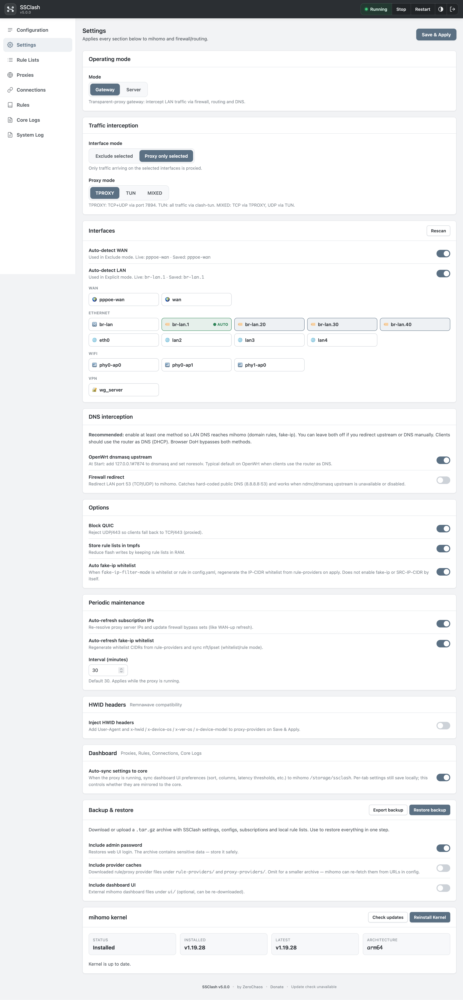
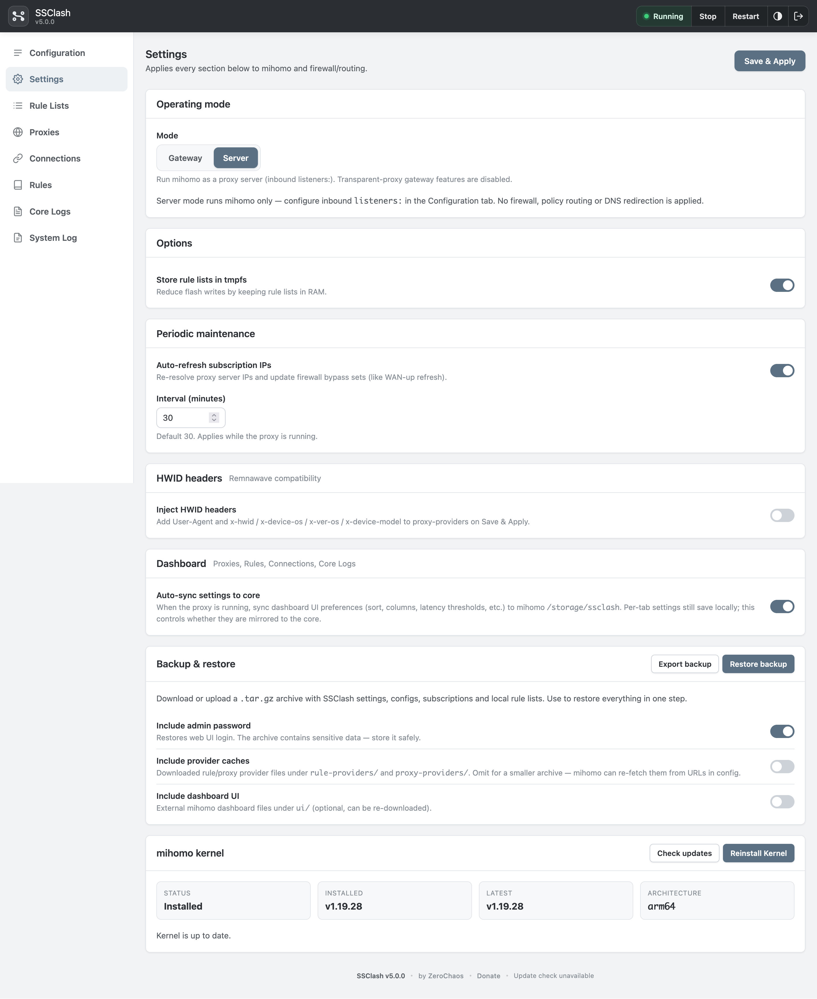
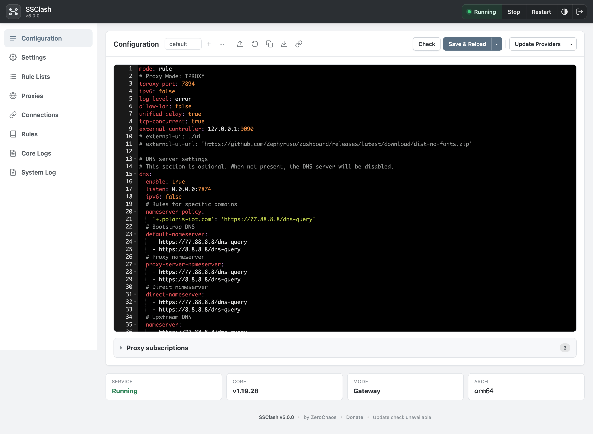
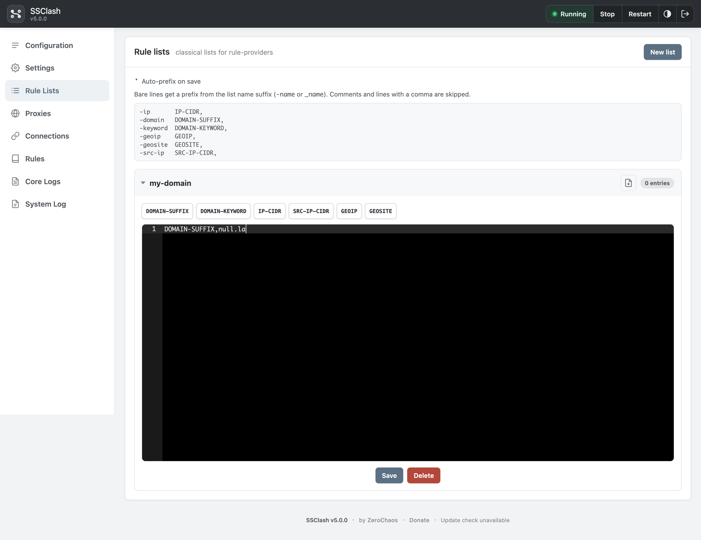
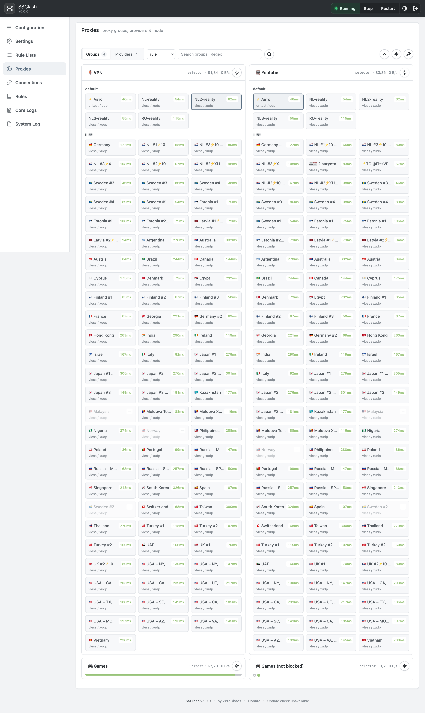
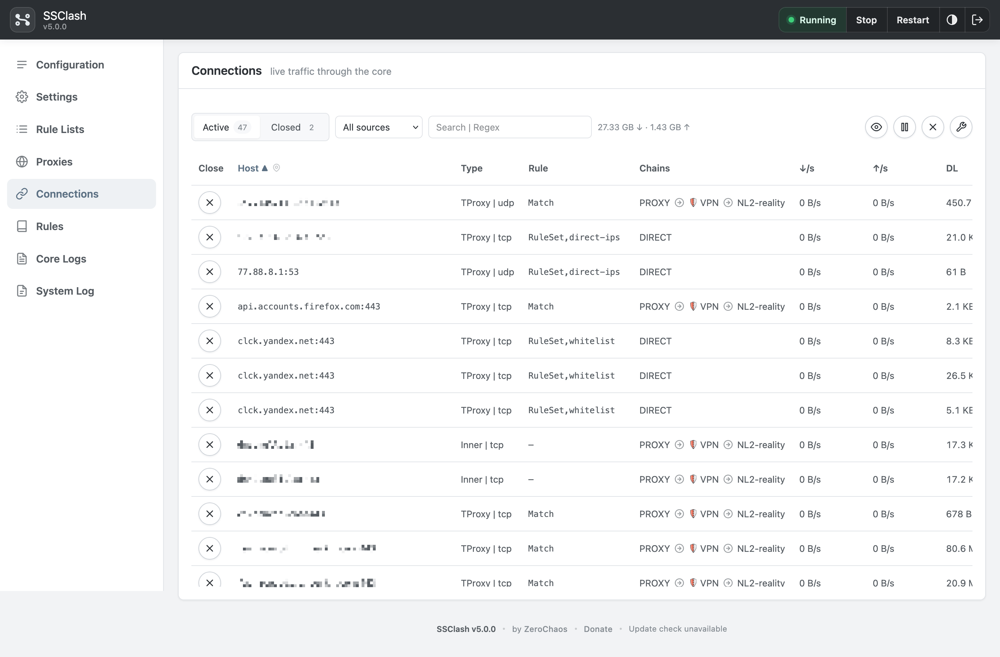
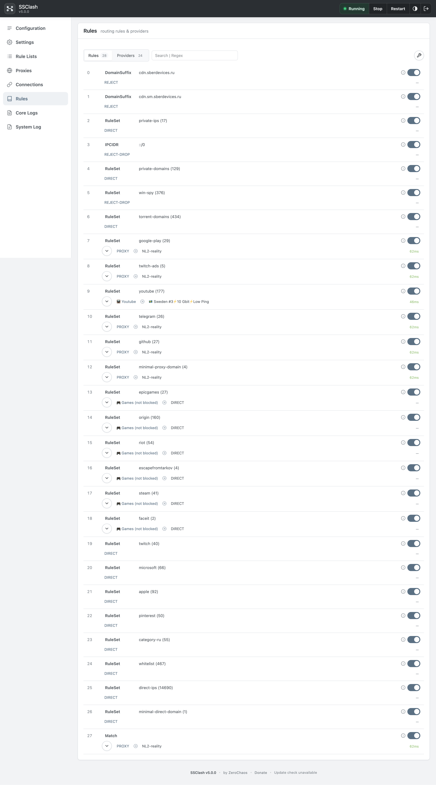
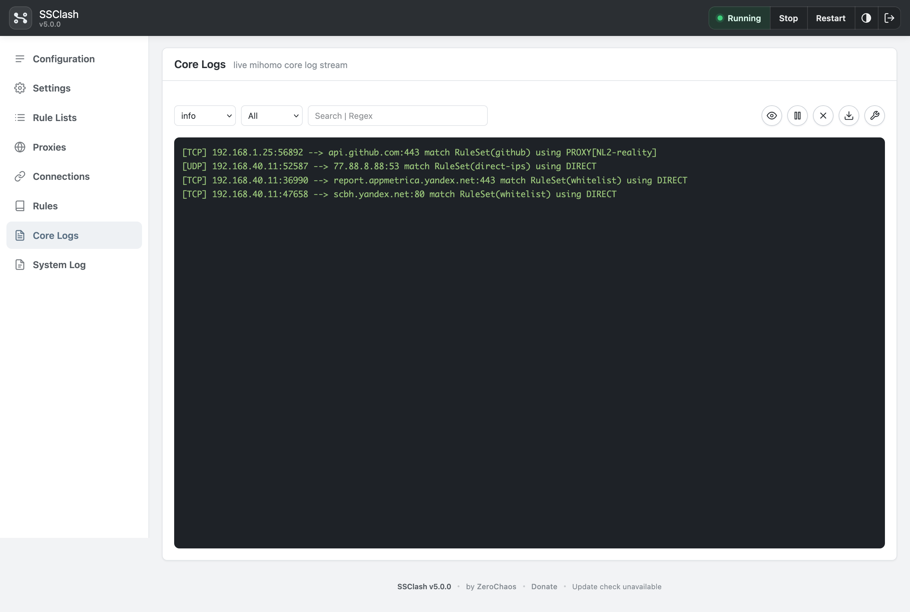
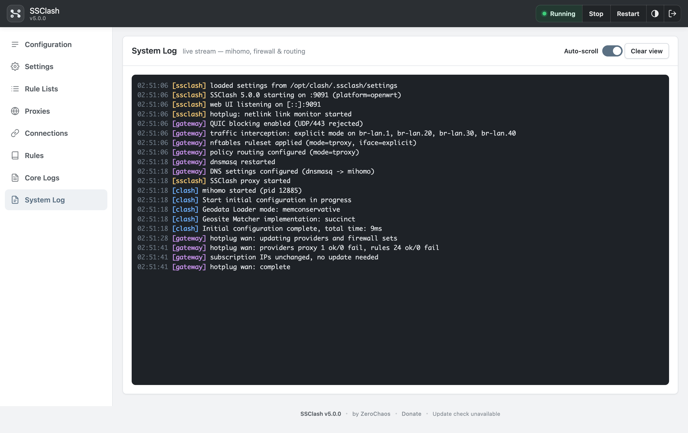

Read this in other languages:
- [Русский](README.ru.md)

<p align="center">
  
</p>

<p align="center"><em>Super Simple Clash — centralized selective routing and transparent proxy powered by Mihomo (Clash.Meta)</em></p>

**SSClash** is a self-contained daemon with an embedded web UI and a native firewall and policy-routing engine for routers and Linux gateways. It requires no LuCI packages or OpenWrt SDK and serves as the modern Go successor to the original [zerolabnet/SSClash](https://github.com/zerolabnet/SSClash) LuCI application while keeping the familiar `/opt/clash` directory layout.

---

## Contents

- [Highlights](#highlights)
- [Quick Start](#quick-start)
  - [1. Install SSClash](#1-install-ssclash)
  - [2. First Run](#2-first-run)
- [Updating SSClash and Mihomo](#updating-ssclash-and-mihomo)
  - [Update from the Web UI (Recommended)](#update-from-the-web-ui-recommended)
  - [Update via the Installer (`--update`)](#update-via-the-installer---update)
- [Common Installation Scenarios & Flags](#common-installation-scenarios--flags)
  - [Installer Options Reference](#installer-options-reference)
  - [Offline & Manual Installation](#offline--manual-installation)
- [Operating Modes & Proxy Modes](#operating-modes--proxy-modes)
  - [Gateway vs. Server Mode](#gateway-vs-server-mode)
  - [Proxy Modes (Gateway)](#proxy-modes-gateway)
  - [Platform Notes: Keenetic](#platform-notes-keenetic)
- [Settings & Traffic Control](#settings--traffic-control)
  - [Interface Selection Modes](#interface-selection-modes)
  - [DNS Interception & DoT/DoH Blocking](#dns-interception--dotdoh-blocking)
  - [Firewall Options & Filtering](#firewall-options--filtering)
  - [Maintenance, RAM Storage, HWID & Backups](#maintenance-ram-storage-hwid--backups)
- [Web UI Guide](#web-ui-guide)
  - [Configuration, Profiles, Subscriptions & Listeners](#configuration-profiles-subscriptions--listeners)
  - [Rule Lists & Fake-IP Whitelist](#rule-lists--fake-ip-whitelist)
  - [Built-in Mihomo Dashboard](#built-in-mihomo-dashboard)
  - [System Log](#system-log)
- [Technical Reference](#technical-reference)
  - [Directory Layout & Migration](#directory-layout--migration)
  - [Command-Line Interface (CLI)](#command-line-interface-cli)
  - [Environment Variables](#environment-variables)
  - [Key Constants & Release Assets](#key-constants--release-assets)
- [Uninstall](#uninstall)
- [License & Support](#license--support)

---

## Highlights

- **Single static binary for every architecture** — pre-built binaries for `amd64`, `arm64`, `armv5`/`v6`/`v7`, `386`, `loong64`, `riscv64`, `ppc64le`, `s390x`, and `mips`/`mipsle` (hardfloat and softfloat). The web UI is embedded directly into the daemon.
- **Full-featured web UI (English & Russian)** — **Configuration** editor, **Settings**, **Rule Lists**, built-in **Proxies / Connections / Rules / Core Logs** dashboard, and live **System Log**.
- **Managed Mihomo core** — automatic architecture detection, one-click download and updates from GitHub Releases (**Stable** and **Alpha** channels), pre-flight `clash -t` config validation, service control, and hot reload via the Mihomo API.
- **Native firewall & routing engine** — atomic `nft -f -` ruleset (`table inet clash`) or `iptables`/`ipset` backend; **TPROXY**, **HYBRID**, **TUN**, **MIXED**, and **MIXED2** capture modes; **Explicit** and **Exclude** interface modes; Keenetic access-policy integration; QUIC and DoT/DoH blocking; port filter; per-client bypass; reserved networks; DSCP bypass and force-proxy marks; optional router self-traffic proxying; forwarded IPv6 drop; and a gateway kill switch.
- **Policy routing** — managed `ip rule` / `ip route` rules (routing tables `100`/`101`; fwmarks `0x1`/`0x2`/`0x3` on OpenWrt and Linux, or `0x80000000`/`0x10000000` with mask `0x90000000` on Keenetic).
- **Secure by default** — mandatory admin password setup on first run (`PBKDF2-HMAC-SHA256`), `HMAC`-signed session cookies, CSRF protection, and optional HTTPS (` TLS`).
- **Cross-platform** — first-class support for **OpenWrt**, **Keenetic (Entware)**, and **generic Linux (systemd)**.

---

## Quick Start

### 1. Install SSClash

The autoinstaller detects your OS and CPU architecture, installs `/opt/clash/bin/ssclash`, downloads the latest **Mihomo** kernel (if not already present or if a newer release is available), and registers the system service.

> [!NOTE]
> If SSClash is already running, the installer **stops the service first** so active transparent-proxy rules do not interrupt GitHub downloads and binaries can be replaced safely.

#### OpenWrt

Stock OpenWrt includes `wget` (`uclient-fetch`) and `ash` out of the box. Run on the router over SSH:

```bash
wget -O /tmp/install-ssclash-go.sh https://github.com/zerolabnet/SSClash-Go/raw/refs/heads/main/install-ssclash-go.sh && ash /tmp/install-ssclash-go.sh
```

#### Keenetic (Entware)

1. Set up **Entware** on a USB drive.
2. In the Keenetic web UI (**General system settings → Components**), make sure these components are installed, and **reboot the router** if prompted:
   - **Open packages (Entware)**
   - **Ext file system**
   - **Netfilter subsystem kernel modules** *(required for kernel `xt_TPROXY` / netfilter support)*
3. Connect to Entware over SSH as `root`. Because firmware BusyBox `wget` lacks HTTPS support (`not an http or ftp url`), install `wget-ssl` and `ca-certificates` from Entware first, then run the installer:

```bash
opkg update && opkg install wget-ssl ca-certificates && export PATH="/opt/bin:/opt/sbin:$PATH" && wget -O /tmp/install-ssclash-go.sh https://github.com/zerolabnet/SSClash-Go/raw/refs/heads/main/install-ssclash-go.sh && ash /tmp/install-ssclash-go.sh
```

#### Generic Linux (systemd)

Requires `systemd`, `ip` (`iproute2`), `nft` or `iptables`, and `curl`:

```bash
curl -fsSL -o /tmp/install-ssclash-go.sh https://github.com/zerolabnet/SSClash-Go/raw/refs/heads/main/install-ssclash-go.sh && sudo sh /tmp/install-ssclash-go.sh
```

---

### 2. First Run

1. Open `http://<router-or-host-ip>:9091` in your browser (or your custom `--port` / HTTPS address) and **choose an admin password**.
   - The web UI is available in **English** and **Russian**. The language switcher in the header remembers your selection (`Auto` uses your browser language). Changing the language reloads the page, and signing out does not reset the selected language.
2. Open the **Configuration** tab — SSClash creates a working default `config.yaml` on first start. Add your proxy subscription (**Add subscription**), paste share links, or load a full remote config (**Load from URL**).
3. Click **Start** in the top toolbar.

> [!TIP]
> If you ran the installer with `--no-mihomo` or the kernel download was interrupted, open **Settings → Mihomo kernel** and click **Download latest kernel** before starting the service.

---

## Updating SSClash and Mihomo

### Update from the Web UI (Recommended)

You can update both SSClash and the Mihomo kernel directly from **Settings** without SSH:

1. **Update SSClash**: Open **Settings → SSClash** (top card). Click **Check updates** to query the latest stable GitHub release, then click **Download update**. SSClash replaces `/opt/clash/bin/ssclash` and restarts the service automatically. *(On systemd Linux, the service user must have permission to run `systemctl restart ssclash.service`.)*
2. **Update Mihomo kernel**: Open **Settings → Mihomo kernel**. Select the release channel (**Stable** for the latest release, or **Alpha** for `mihomo-linux-*-alpha-*` builds) and click **Check updates** or **Download / Update**.
   - On `amd64`, downloading the kernel from the web UI selects a build the processor can execute: the standard `mihomo-linux-amd64` asset is built for `x86-64-v3`, while older processors receive a `v1` or `compatible` build if present in the release.
   - On small flash storage, SSClash streams the new kernel directly over the old binary without keeping a second uncompressed copy in `/tmp`, and automatically cleans up temporary `.mihomo-new.*` files if a download fails.

### Update via the Installer (`--update`)

Passing `--update` to the installer upgrades **only** the SSClash binary and the Mihomo kernel (when a newer release exists). Your operating mode (`gateway`/`server`), listen address, TLS configuration, `config.yaml`, and service unit/init script are preserved.

**OpenWrt & Keenetic (Entware):**

```bash
export PATH="/opt/bin:/opt/sbin:$PATH" && wget -O /tmp/install-ssclash-go.sh https://github.com/zerolabnet/SSClash-Go/raw/refs/heads/main/install-ssclash-go.sh && ash /tmp/install-ssclash-go.sh --update
```

**Generic Linux (systemd):**

```bash
curl -fsSL -o /tmp/install-ssclash-go.sh https://github.com/zerolabnet/SSClash-Go/raw/refs/heads/main/install-ssclash-go.sh && sudo sh /tmp/install-ssclash-go.sh --update
```

---

## Common Installation Scenarios & Flags

Each command below downloads a fresh copy of the installer to `/tmp/install-ssclash-go.sh` and runs it with the desired flags *(on Keenetic Entware, prepend `export PATH="/opt/bin:/opt/sbin:$PATH" && ` if `/opt/bin` is not already first in `PATH`)*:

- **Dedicated Proxy Server on a Linux VPS (`--mode server`)**
  Runs Mihomo as an inbound server without gateway firewall or routing rules, binds the web UI to port `8443` with a self-signed HTTPS certificate, and seeds `config.yaml` with an example `listeners:` block:
  ```bash
  curl -fsSL -o /tmp/install-ssclash-go.sh https://github.com/zerolabnet/SSClash-Go/raw/refs/heads/main/install-ssclash-go.sh && sudo sh /tmp/install-ssclash-go.sh --mode server --port 8443 --tls-self-signed
  ```
- **Custom Web UI Port & Self-Signed HTTPS on a Router**
  Changes the web UI port from `9091` to `8443` and generates `$ROOT/.ssclash/tls.{crt,key}` (requires `openssl`):
  ```bash
  wget -O /tmp/install-ssclash-go.sh https://github.com/zerolabnet/SSClash-Go/raw/refs/heads/main/install-ssclash-go.sh && ash /tmp/install-ssclash-go.sh --port 8443 --tls-self-signed
  ```
- **Bind Web UI to LAN IP Only**
  Restricts the web UI listener to a specific interface address instead of `0.0.0.0`:
  ```bash
  wget -O /tmp/install-ssclash-go.sh https://github.com/zerolabnet/SSClash-Go/raw/refs/heads/main/install-ssclash-go.sh && ash /tmp/install-ssclash-go.sh --bind 192.168.1.1 --port 9091
  ```
- **Install SSClash Without Downloading Mihomo (`--no-mihomo`)**
  Useful when you already have a custom `/opt/clash/bin/clash` binary or want to download the kernel later from the Web UI:
  ```bash
  wget -O /tmp/install-ssclash-go.sh https://github.com/zerolabnet/SSClash-Go/raw/refs/heads/main/install-ssclash-go.sh && ash /tmp/install-ssclash-go.sh --no-mihomo
  ```
- **Update Only SSClash and Keep Existing Mihomo Kernel (`--update --no-mihomo`)**
  ```bash
  wget -O /tmp/install-ssclash-go.sh https://github.com/zerolabnet/SSClash-Go/raw/refs/heads/main/install-ssclash-go.sh && ash /tmp/install-ssclash-go.sh --update --no-mihomo
  ```

### Installer Options Reference

| Flag | Description |
| :--- | :--- |
| `--port <n>` | Web UI port (default: `9091` on all interfaces). |
| `--bind <ip>` | Bind the web UI to a specific IP address (used together with `--port`). |
| `--addr <host:port>` | Full `SSCLASH_ADDR` listen address (overrides `--port` and `--bind`). |
| `--root <path>` | **OpenWrt only** — installation directory (default: `/opt/clash`; preserved across upgrades unless passed again). |
| `--tls-cert <path>` | Path to a PEM TLS certificate for the web UI (requires `--tls-key`). |
| `--tls-key <path>` | Path to a PEM TLS private key for the web UI (requires `--tls-cert`). |
| `--tls-self-signed` | Generate a self-signed certificate at `$ROOT/.ssclash/tls.{crt,key}` (requires `openssl`). |
| `--mode gateway\|server` | **Linux only** — operating mode: `gateway` (transparent proxy) or `server` (inbound server; seeds a sample `listeners:` block in `config.yaml` on fresh install). |
| `--version <tag>` | Install a specific SSClash release tag (default: latest release). |
| `--from <path>` | Install SSClash from a local binary path instead of downloading from GitHub. |
| `--no-mihomo` | Skip downloading the Mihomo kernel. |
| `--update` | Upgrade an existing installation (replaces only SSClash and Mihomo; preserves mode, address, TLS, and service file). Can be combined with `--from`, `--version`, and `--no-mihomo`. Do not combine with `--mode`, `--port`, `--bind`, `--addr`, `--root`, or `--tls-*`. |

> [!NOTE]
> Platform-specific installer scripts with identical behavior are located in `packaging/{openwrt,linux,keenetic}/`.

---

### Offline & Manual Installation

Use the sections below when your router or server cannot reach GitHub or OS package repositories directly.

<details>
<summary><strong>OpenWrt — Manual & Offline Installation / Update</strong></summary>

#### Manual Installation on OpenWrt

1. **Update package index:**
   ```bash
   # OpenWrt >= 25 (apk):
   apk update

   # OpenWrt < 25 (opkg):
   opkg update
   ```
2. **Install required kernel modules and packages:**
   - `kmod-tun` — required for TUN, MIXED, and MIXED2 modes
   - `kmod-nft-tproxy` — transparent proxy support for `firewall4` / `nftables`
   - `iptables-mod-tproxy` — transparent proxy support for legacy `firewall3` / `iptables` (OpenWrt < 22.03)
   ```bash
   # OpenWrt >= 25 (firewall4 / nftables):
   apk add kmod-tun kmod-nft-tproxy

   # OpenWrt 22.03 – 24.x (firewall4 / nftables):
   opkg install kmod-tun kmod-nft-tproxy

   # OpenWrt < 22.03 (firewall3 / iptables):
   opkg install kmod-tun iptables-mod-tproxy
   ```
3. **Download and install the SSClash binary and init service:**
   Pick the binary matching your architecture from [GitHub Releases](https://github.com/zerolabnet/SSClash-Go/releases) and replace `<tag>` with the release version:
   ```bash
   mkdir -p /opt/clash/bin
   wget -O /opt/clash/bin/ssclash \
     https://github.com/zerolabnet/SSClash-Go/releases/download/<tag>/ssclash-linux-arm64
   chmod +x /opt/clash/bin/ssclash

   wget -O /tmp/ssclash-openwrt-service.tar.gz \
     https://github.com/zerolabnet/SSClash-Go/releases/download/<tag>/ssclash-openwrt-service.tar.gz
   tar -xzf /tmp/ssclash-openwrt-service.tar.gz -C /
   /etc/init.d/ssclash enable
   /etc/init.d/ssclash start
   ```

#### Offline Update on OpenWrt

> [!IMPORTANT]
> A first-time run of `install-openwrt.sh` refreshes the package index (`opkg update` / `apk update`) and stops if the feed is unreachable, even when packages are already installed. For an existing installation, you can update completely offline.

1. Copy `packaging/openwrt/install-openwrt.sh` from this repository and the matching `ssclash-linux-*` binary to `/tmp/` on the router. (`curl` or `wget-ssl` must already be installed; if only stock `uclient-fetch` is present, the script will attempt to update the package feed.)
2. Optionally, unpack the new Mihomo binary to `/opt/clash/bin/clash` (`gunzip` the matching `mihomo-linux-*.gz` and run `chmod 755 /opt/clash/bin/clash`).
3. Run the offline update (preserves the init script, listen address, TLS settings, and install root):
   ```bash
   sh /tmp/install-openwrt.sh --update --from /tmp/ssclash-linux-arm64 --no-mihomo
   ```
4. To update the init script offline as well:
   ```bash
   /etc/init.d/ssclash stop
   tar -xzf /tmp/ssclash-openwrt-service.tar.gz -C /
   /etc/init.d/ssclash start
   ```

</details>

<details>
<summary><strong>Keenetic (Entware) — Offline Installation & Update</strong></summary>

Use this procedure when the Keenetic router has no direct access to GitHub or the Entware package repository. Download the required files on another computer and copy them to `/tmp` on the router via SCP or USB.

1. **Select the right binaries for your CPU (`uname -m`):**
   - `aarch64` / `arm64` → `ssclash-linux-arm64` and `mihomo-linux-arm64-<tag>.gz`
   - `armv7l` → `ssclash-linux-armv7` and `mihomo-linux-armv7-<tag>.gz`
   - `mipsel` / `mips` → `hardfloat` if `opkg print-architecture` contains `hard`, otherwise `softfloat`
   - Also download `ssclash-keenetic-service.tar.gz` (contains `opt/etc/init.d/S99ssclash`) and `packaging/keenetic/install-keenetic.sh`.
2. **Download required Entware `.ipk` packages (plus their `Depends:`):**
   - `ip-full`, `conntrack`, `ipset`
   - `iptables-legacy` (or `iptables` if `iptables -V` does not report `nf_tables`). You can skip `iptables-legacy` if firmware `/sbin/iptables` is already an `xtables` binary.
   - *(Note: BusyBox `wget` or `curl` must exist on `PATH` because the installer checks for one of them.)*
3. **Prepare the layout and run the offline installer:**
   ```bash
   mkdir -p /tmp/ssclash-offline/etc/init.d /tmp/ssclash-offline/ipk /tmp/ssclash-svc
   # Copy install-keenetic.sh, ssclash binary, .ipk files, and ssclash-keenetic-service.tar.gz to /tmp/

   tar -xzf /tmp/ssclash-keenetic-service.tar.gz -C /tmp/ssclash-svc
   cp /tmp/ssclash-svc/opt/etc/init.d/S99ssclash /tmp/ssclash-offline/etc/init.d/

   export PATH="/opt/bin:/opt/sbin:$PATH"
   opkg install /tmp/ssclash-offline/ipk/*.ipk

   mkdir -p /opt/clash/bin
   gunzip -c /tmp/mihomo-linux-arm64-<tag>.gz > /opt/clash/bin/clash
   chmod 755 /opt/clash/bin/clash

   sh /tmp/ssclash-offline/install-keenetic.sh --from /tmp/ssclash-offline/ssclash-linux-arm64 --no-mihomo
   ```
4. **Offline update of an existing Keenetic installation:**
   ```bash
   sh /tmp/ssclash-offline/install-keenetic.sh --update --from /tmp/ssclash-offline/ssclash-linux-arm64 --no-mihomo
   ```

</details>

<details>
<summary><strong>Generic Linux (systemd) — Offline Installation & Update</strong></summary>

1. Save `packaging/linux/install-linux.sh` from this repository and download the matching binary (`x86_64` → `ssclash-linux-amd64`, `aarch64` → `ssclash-linux-arm64`). The script generates the `systemd` unit directly (no service tarball is needed).
2. Make sure `ip` and either `nft` or `iptables` are installed. In Gateway mode, the installer also attempts `apt-get install conntrack ipset` if missing (if offline, install `conntrack` and `ipset` beforehand; `apt-get` failure only logs a warning).
3. Place the Mihomo binary at `/opt/clash/bin/clash` (`chmod 755`).
4. **Fresh offline install:**
   ```bash
   sudo sh /tmp/install-linux.sh --from /tmp/ssclash-linux-amd64 --mode gateway --no-mihomo
   ```
5. **Offline update of an existing installation:**
   ```bash
   sudo sh /tmp/install-linux.sh --update --from /tmp/ssclash-linux-amd64 --no-mihomo
   ```

</details>

<details>
<summary><strong>Manual Mihomo Kernel Installation</strong></summary>

If you prefer to install or replace the Mihomo kernel manually from [MetaCubeX/mihomo Releases](https://github.com/MetaCubeX/mihomo/releases), download `mihomo-linux-<arch>-<tag>.gz`, decompress it to `/opt/clash/bin/clash`, and make it executable:

```bash
cd /opt/clash/bin
wget -O clash.gz \
  https://github.com/MetaCubeX/mihomo/releases/download/<tag>/mihomo-linux-arm64-<tag>.gz
gunzip clash.gz && chmod +x clash
```

Restart the SSClash service after replacing the kernel.

</details>

---

## Operating Modes & Proxy Modes

### Gateway vs. Server Mode

SSClash operates in one of two modes (**Settings → Operating mode**):

- **Gateway** *(default on routers)* — Transparent-proxy gateway that intercepts LAN traffic with firewall rules, policy routing, and DNS redirection.
- **Server** — Runs the Mihomo core only without touching firewall rules, policy routing, or system DNS. Enables the visual **Listeners** builder on the **Configuration** tab for configuring inbound proxy listeners (`listeners:`).

### Proxy Modes (Gateway)

When **Save & Apply** or **Start** runs, SSClash automatically synchronizes the required port and `tun:` settings in the active `config.yaml`, validates the file with `clash -t`, and applies the netfilter/routing rules:

| Mode | Traffic Capture Mechanism | `config.yaml` (auto-synced) | Best For / Notes |
| :--- | :--- | :--- | :--- |
| **TPROXY** | `mangle` TPROXY to `:7894` (TCP & UDP) | `tproxy-port: 7894` | **Default on OpenWrt & Linux.** Uses policy-routing marks; no `clash-tun` device needed. |
| **HYBRID** | TCP via `nat` DNAT → `127.0.0.1:7893`; UDP via TPROXY `:7894` | `redir-port: 7893`, `tproxy-port: 7894` | **Default on Keenetic.** Supports all SSClash firewall options and works with router HTTPS on port 443. |
| **TUN** | Packet mark (`fwmark`) → `clash-tun` (TCP & UDP) | `tun:` block (`auto-route: false`, `auto-redirect: false`) | Full L3 tunnel on OpenWrt, Linux, and Keenetic. Selectable stack in Settings. |
| **MIXED** | TCP via TPROXY `:7894`; UDP via `clash-tun` | `tproxy-port: 7894` + `tun:` | Split path when TPROXY handles UDP/QUIC poorly. *(Avoid on Keenetic if router HTTPS is on 443 — use **MIXED2** instead.)* |
| **MIXED2** | TCP via `nat` DNAT → `127.0.0.1:7893`; UDP via `clash-tun` | `redir-port: 7893` + `tun:` *(no `tproxy-port`)* | **Recommended on Keenetic for heavy UDP/QUIC:** combines HYBRID TCP compatibility with `clash-tun` UDP. |

**TUN Stack (`tun.stack`):** For **TUN**, **MIXED**, and **MIXED2**, you can choose the stack in **Settings**:
- **`system`** *(default)* — kernel network stack; best performance on Linux and OpenWrt.
- **`gvisor`** — userspace network stack; try if `system` is unstable on your platform.
- **`mixed`** — `system` stack for TCP + `gvisor` stack for UDP.
- **`mips`** — pure-Go userspace stack ([mipstack](https://github.com/MetaCubeX/mipstack)), designed for MIPS routers where `system` or `gvisor` is unavailable or unstable.

---

### Platform Notes: Keenetic

- **Recommended Proxy Modes on Keenetic (in order):**
  1. **HYBRID** *(installer default)* — full SSClash firewall features; no conflict with Keenetic management HTTPS on TCP port 443.
  2. **MIXED2** — same `nat` DNAT path for TCP as HYBRID, plus `clash-tun` for better UDP/QUIC handling.
  3. **TPROXY** — works only if you move the Keenetic web UI HTTPS management port off TCP `443` (e.g. to `8443`).
  4. **TUN** — SSClash marks TCP and UDP into `clash-tun` (same architecture as OpenWrt). Supports access policies, bypass clients, port filter, and reserved networks. *(If upgrading from an older build that used Mihomo `auto-redirect`, click **Stop** and then **Start**.)*
- **Keenetic Access Policies:** In **Settings → Keenetic access policy**, enable **Respect Keenetic access policy** and select one or more policies configured in the Keenetic web UI (**Internet → Access policies**). SSClash matches NDMS `connmark` values so only LAN clients assigned to those policies enter the proxy (works in all proxy modes, including **TUN**).
- **RCI Access Token (KeeneticOS 5.2+):** Starting with KeeneticOS 5.2, local RCI (`127.0.0.1:79`) requires an authentication token for policy filtering and accurate policy/client names. Create a token in the Keenetic web UI under **Users and access**, paste it into **Settings → Keenetic access policy → RCI access token**, and click **Save & Apply**.

<details>
<summary><strong>Keenetic Architecture Details (iptables, NDMS Netfilter Hook, TCP 443 Limit)</strong></summary>

- **Fixed `iptables` (xtables) Backend:** KeeneticOS does not support kernel `nftables` for LAN forwarding. SSClash locks the firewall backend to `iptables` (`xtables`) and starts Mihomo with `DISABLE_NFTABLES=1` in TUN mode. Entware binaries where `iptables -V` reports `nf_tables` cannot intercept Keenetic LAN traffic and are rejected on start; SSClash uses firmware `/sbin/iptables` or installs `iptables-legacy` / xtables `iptables` automatically.
- **Full `iproute2` Required:** BusyBox `ip` on Keenetic lacks `ip rule` support. The installer automatically runs `opkg install ip-full` when `ip rule` is unavailable.
- **NDMS Netfilter Hook (`/opt/etc/ndm/netfilter.d/50-ssclash.sh`):** KeeneticOS flushes and rebuilds `filter`/`nat`/`mangle` tables whenever router settings are saved or WAN reconnects. While running, SSClash installs an official NDMS hook (24-second timeout) that immediately restores `PREROUTING -j CLASH` and DNS/QUIC jumps using the resolved xtables `iptables` binary, running a full reload only if custom chains were deleted.
- **Why TPROXY Conflicts with TCP Port 443 on Keenetic:** KeeneticOS reserves port 443 internally in `xt_TPROXY` when router HTTPS management listens on 443, preventing LAN HTTPS traffic from reaching Mihomo in `TPROXY` or `MIXED` mode. Using **HYBRID**, **MIXED2**, **TUN**, or moving Keenetic HTTPS management to another port (such as `8443`) avoids this limitation completely.

</details>

---

## Settings & Traffic Control

### Interface Selection Modes

Under **Settings → Traffic interception → Interface mode**, choose how SSClash selects incoming traffic:

- **Explicit mode (`Proxy only selected` — Recommended)**
  Intercepts traffic **only** on the interfaces you check (for example, a specific LAN bridge or VLAN). Traffic on all other interfaces is ignored at the firewall level and never reaches Mihomo. **Auto-detect LAN** automatically adds the primary LAN interface.
- **Exclude mode (`Exclude selected` — Simple Default)**
  Acts as a whole-LAN gateway: intercepts traffic on **all** interfaces except those you select (typically your WAN interface). **Auto-detect WAN** automatically adds the detected WAN interface to the bypass list.
- **Firewall backend (`Auto` / `nftables` / `iptables`)**
  Available on OpenWrt and generic Linux under **Settings → Traffic interception**: **Auto** selects `nftables` (`table inet clash`) when `nft` is supported by the kernel and falls back to `iptables` otherwise; you can also force **nftables** or **iptables** explicitly. On Keenetic, the backend is fixed to **iptables** (`xtables`).

---

### DNS Interception & DoT/DoH Blocking

Sending LAN DNS queries to Mihomo (`:7874`) is strongly recommended so domain rules (`DOMAIN-SUFFIX`, `GEOSITE`) and `fake-ip` work properly. Clients should receive the router IP as their DNS server via DHCP.

#### DNS Modes on OpenWrt vs. Keenetic / Linux

- **OpenWrt dnsmasq upstream** *(default on OpenWrt)* — On **Start**, SSClash adds `127.0.0.1#7874` as the upstream server in `dnsmasq` and sets `noresolv=1` (backing up original UCI settings in `.ssclash/` and restoring them on **Stop**).
- **Firewall redirect** *(default on Keenetic and Linux; optional on OpenWrt)* — Redirects LAN TCP/UDP port `53` directly to Mihomo (`:7874`) via netfilter without modifying `dnsmasq`. Also catches hard-coded public DNS servers (such as `8.8.8.8:53`) on LAN clients. Keep `dns.listen: 0.0.0.0:7874` in `config.yaml`. *(On OpenWrt, **OpenWrt dnsmasq upstream** and **Firewall redirect** are mutually exclusive.)*

#### Blocking Encrypted DNS Bypass (DoT / DoH)

Even when port `53` is intercepted, devices with encrypted DNS (such as Android Private DNS or browsers with DoH enabled) can bypass Mihomo. When DNS interception is active, **Settings → DNS interception** provides three pre-proxy drop switches for LAN clients:

- **Block DoT (port 853)** — Drops LAN TCP/UDP packets to port `853`, forcing clients to fall back to standard DNS through Mihomo.
- **Block known DoH (dibdot)** — Drops LAN TCP/UDP packets to port `443` for IPv4 addresses in the [dibdot DoH IP blocklists](https://github.com/dibdot/DoH-IP-blocklists) (downloaded at runtime and refreshed daily).
  > [!WARNING]
  > Blocking known DoH IPs also blocks direct HTTPS access to those IP addresses (such as `https://1.1.1.1/` or `https://8.8.8.8/`) from filtered LAN clients.
- **Block DoH (custom list)** — Applies the same port `443` drop to your own list of `https://host/path` URLs (stored in `.ssclash/doh-custom.txt`; hostnames are resolved to IPv4 on save).

> [!NOTE]
> - DoT/DoH drops apply only to LAN IPv4 traffic; the router itself and **Bypass clients (firewall)** are not affected.
> - On the `iptables` backend, DoH IP blocking requires `ipset` (`iptables-mod-tproxy` on OpenWrt, `xt_set` on Keenetic).
> - If `conntrack` (`conntrack-tools`) is installed, SSClash flushes existing LAN sessions on port `53` when toggling Firewall redirect and on port `853` when enabling Block DoT so changes take effect immediately.

---

### Firewall Options & Filtering

All firewall options below are configured in **Settings → Options** (Gateway mode):

| Option | Purpose & Behavior |
| :--- | :--- |
| **Block QUIC** | Rejects `UDP/443` on LAN ingress so browsers and apps quickly fall back to `TCP/443` through the proxy (improves YouTube and HTTP/3 proxying). |
| **Bypass clients (firewall)** | Source IPv4 addresses/CIDRs that completely skip transparent-proxy marking and firewall DNS redirection in all modes (including TUN). Checked *before* Keenetic access policies and Mihomo `SRC-IP-CIDR` rules. *(If you use `fake-ip`, assign a public DNS server directly on bypassed devices, especially when using OpenWrt `dnsmasq` upstream.)* |
| **Port filter (firewall)** | Filters destination TCP/UDP ports in netfilter *before* Mihomo:<br>• **Bypass destination ports** — traffic to these ports never enters Mihomo (use **Torrent bypass** if your client uses a fixed port range).<br>• **Proxy destination ports only** — only listed ports enter Mihomo. On weak routers, click **Common ports only** (`80, 443, …`) so random high-port BitTorrent traffic stays out of the core. *(If both lists are set, bypass takes priority.)* |
| **Reserved networks (firewall)** | Destination IPv4 CIDRs that bypass transparent-proxy marking. Includes RFC special-use subnets and CGNAT `100.64.0.0/10` (**Tailscale / Headscale CGNAT** — remove it if you want Tailnet traffic routed through Mihomo; Mihomo `private-ips` rules are separate). *(In **TPROXY**, **HYBRID**, and **MIXED** modes, table `100` also receives a `scope-link` route for each connected IPv4 prefix on an intercepted interface so `fwmark` source lookup succeeds when Tailscale sets `src_valid_mark=1`; **TUN** and **MIXED2** do not add these routes.)* |
| **Proxy router traffic** | Routes the router's own outbound IPv4 TCP/UDP traffic (`OUTPUT` chain) through Mihomo using the same firewall exclusions as LAN clients. *(Keenetic access policies and the Kill switch do not apply to the router itself.)* |
| **DSCP marks (firewall)** | Matches IP packet DSCP values set by client OS/apps:<br>• **DSCP bypass** (e.g. `62`) — skips proxy interception, firewall DNS redirect, QUIC block, and DoT/DoH blocks.<br>• **DSCP force proxy** (e.g. `63`) — forces traffic into Mihomo, bypassing interface selection, Keenetic access policies, `fake-ip` destination filtering, and port filter (still respects QUIC and DoT/DoH blocks). |
| **Drop forwarded IPv6** | Drops transit IPv6 traffic forwarded from LAN clients so clients stay on IPv4 through Mihomo, while the router keeps its own IPv6 connectivity. |
| **Kill switch** | Blocks LAN-to-WAN internet forwarding whenever the proxy is stopped. Router Web UI, SSH, router self-traffic, LAN-to-LAN traffic, and existing WAN port forwards remain reachable. Persists across `fw4` reloads on OpenWrt (`/var/etc/ssclash-ks.include`) and NDMS rebuilds on Keenetic. |

---

### Maintenance, RAM Storage, HWID & Backups

- **Auto fake-ip whitelist & RAM storage (`Store rule lists in tmpfs`):**
  - **Auto fake-ip whitelist** automatically rebuilds the `AUTO` block in `local-rules/fakeip-whitelist-ipcidr.txt` on **Start** and **Apply** from inline `IP-CIDR` rules that route to a proxy or proxy group, `IP-CIDR` entries from `rule-providers` referenced by such rules, and `dns.fake-ip-filter` entries (when `fake-ip-filter-mode` is `whitelist` or `rule`). See [Rule Lists & Fake-IP Whitelist](#rule-lists--fake-ip-whitelist) for details.
  - **Store rule lists in tmpfs** symlinks `rule-providers/` and `proxy-providers/` to RAM (`/tmp/ssclash`) to reduce flash/NAND wear on routers.
- **Periodic maintenance:**
  - **Auto-refresh subscription IPs** — periodically re-resolves proxy server hostnames and updates firewall bypass sets (just like a WAN-up refresh).
  - **Auto-refresh fake-ip whitelist** — periodically rebuilds whitelist CIDRs and syncs `nft`/`ipset` sets while the proxy is running (default interval: `30` minutes, range `5–1440`).
- **Remnawave compatibility (`Inject HWID headers`):**
  - Automatically attaches `User-Agent`, `x-hwid` (16-character MD5 derived from LAN MAC or custom), `x-device-os`, `x-ver-os`, and `x-device-model` headers to `proxy-providers` and remote config requests.
- **NAT masquerade on WAN *(Generic Linux only)*:**
  - Applies a runtime `MASQUERADE` rule for LAN clients using the Linux machine as their default gateway without modifying files in `/etc`.
- **Backup & restore:**
  - Export or restore a single `.tar.gz` archive containing SSClash settings, named config profiles, subscriptions, custom DoH lists, and local rule lists (with optional inclusion of the admin password, external dashboard UI files, and provider caches).

<details>
<summary><strong>Screenshots: Settings (Gateway & Server Modes)</strong></summary>

<p align="center">
  
</p>

<p align="center">
  
</p>

</details>

---

## Web UI Guide

### Configuration, Profiles, Subscriptions & Listeners

The **Configuration** tab provides a full YAML editor with section navigation and subscription management:

- **Named Config Profiles** — create, duplicate, rename, switch, and delete profiles stored in `configs/`.
- **Proxy Subscriptions** — add HTTPS subscription URLs or paste share links (`vless://`, `vmess://`, `trojan://`, `ss://`, `ssr://`, `hysteria2://`, `tuic://`, `anytls://`, `mieru://`, `socks5://`). Subscriptions can be toggled on/off (commented out in YAML) or updated via the Mihomo API without losing active connections.
- **Load Full Config from URL (`profile remote`)** — fetches a complete Mihomo YAML into the `remote` profile (Remnawave `/sub/{token}` URLs automatically retry `/sub/{token}/mihomo`) with optional scheduled auto-updates (`Profile-Update-Interval` or custom `1–168h`).
- **Inbound Listeners *(Server mode only)*** — click **Add listener** in the top action bar to build an inbound Mihomo listener (`listeners:` entry); the **Listeners** card appears once at least one listener exists.

<details>
<summary><strong>Screenshot: Configuration Editor</strong></summary>

<p align="center">
  
</p>

</details>

---

### Rule Lists & Fake-IP Whitelist

The **Rule Lists** tab manages local classical rule files under `local-rules/` for use with `rule-providers`:

- **Auto-prefix on save** — bare lines automatically receive a Clash rule prefix based on the list filename suffix (`-domain`, `-keyword`, `-ip`, `-src-ip`, `-geoip`, `-geosite`).
- **One-click insertion** — **Add to config** inserts the list as a `rule-provider` in `config.yaml`.
- **Fake-IP Whitelist (`local-rules/fakeip-whitelist-ipcidr.txt`)**:
  - **What goes into the `AUTO` block** — inline `IP-CIDR` rules whose action routes to a proxy or a proxy group (`DIRECT`, `REJECT`, `REJECT-DROP`, and `PASS` are excluded; IPv6 and `SRC-IP-CIDR` are excluded), `IP-CIDR` entries from `rule-providers` referenced by such rules, and `dns.fake-ip-filter` entries. These are real destination IPv4 addresses/subnets: matching DNS queries receive a real IP address instead of a `fake-ip`, while the firewall still routes traffic to those addresses into the Mihomo core.
  - **Save vs. Regenerate** — clicking **Save** writes the file text as-is and, if the proxy is running, updates the kernel set without rebuilding the `AUTO` block. Rebuilding the `AUTO` block is triggered by the **Regenerate** button, as well as on **Start** and **Apply** when **Auto fake-ip whitelist** is enabled. Manual lines outside the `AUTO` markers are preserved across rebuilds; edits inside the `AUTO` markers last until the next rebuild.
  - **Progress banner** — while the whitelist is being built or loaded into the kernel, a persistent banner remains under the header warning that a large network list may take several minutes (not a pop-up toast notification). System log lines for this work remain in English.

<details>
<summary><strong>Screenshot: Rule Lists</strong></summary>

<p align="center">
  
</p>

</details>

---

### Built-in Mihomo Dashboard

SSClash includes a native four-tab Mihomo dashboard — **Proxies**, **Connections**, **Rules**, and **Core Logs**:

- **Secure API proxying** — the browser communicates only with `/api/mihomo/*` over your authenticated SSClash session; Mihomo's `external-controller` (`:9090`) and `secret` never need to be exposed to the network.
- **Cross-device preference sync** — UI preferences (sorting, table columns, latency thresholds) are saved in `localStorage` and optionally mirrored to Mihomo's `/storage/ssclash` endpoint when **Auto-sync settings to core** is enabled.
- **External UI support** — if you configure `external-ui` in `config.yaml` and place a third-party dashboard in `ui/`, clicking **Open dashboard** on the Configuration tab opens it in a new tab.

<details>
<summary><strong>Screenshots: Proxies, Connections, Rules & Core Logs</strong></summary>

<p align="center">
  
</p>

<p align="center">
  
</p>

<p align="center">
  
</p>

<p align="center">
  
</p>

</details>

---

### System Log

The **System Log** tab streams real-time Server-Sent Events (SSE) across all components in one place, color-coded by source:
- `clash` — Mihomo core startup and runtime output
- `gateway` — firewall rules, policy routing, DNS interception, and hotplug events
- `ssclash` — daemon lifecycle and web UI events

<details>
<summary><strong>Screenshot: System Log</strong></summary>

<p align="center">
  
</p>

</details>

---

## Technical Reference

### Directory Layout & Migration

All persistent files reside under `/opt/clash` by default (override with `SSCLASH_ROOT`):

```text
/opt/clash/
├── bin/ssclash              # SSClash daemon binary
├── bin/clash                # Mihomo kernel binary
├── config.yaml              # Active configuration file
├── configs/                 # Named configuration profiles
├── local-rules/             # Local user rule lists (was lst/ in LuCI SSClash)
├── rule-providers/          # Downloaded rule-provider files (was ruleset/)
├── proxy-providers/         # Downloaded proxy-provider files (was proxy_providers/)
├── subscriptions/           # Pasted share-link lists (file providers)
├── ui/                      # Optional external dashboard files
├── .ssclash/                # Settings, password hash, session key, doh-custom.txt, UCI backup
└── (runtime) /tmp/ssclash/  # Ephemeral caches, tmpfs symlinks, resolved IP sets
```

<details>
<summary><strong>Migrating from Legacy LuCI SSClash</strong></summary>

SSClash (Go) uses the same `/opt/clash/config.yaml` and `/opt/clash/bin/clash` kernel path as the original LuCI application. If upgrading in place, rename the following paths:

| Legacy LuCI SSClash | SSClash (Go) |
| :--- | :--- |
| `lst/` | `local-rules/` |
| `ruleset/` | `rule-providers/` |
| `proxy_providers/` | `proxy-providers/` |
| `settings` (in root) | `.ssclash/settings` |
| `/tmp/clash/` | `/tmp/ssclash/` |

</details>

---

### Command-Line Interface (CLI)

```text
ssclash [serve]              Run the daemon and web UI (default)
ssclash fw start|stop|update Apply, remove, or refresh firewall and policy routing
ssclash fw validate-policy   Check policy routing rules and tables
ssclash fw repair-policy     Repair policy routing rules and tables
ssclash fw validate-forward  Check firewall forwarding rules
ssclash fw repair-forward    Repair firewall forwarding rules
ssclash fw ndm-reload        Restore SSClash jumps after KeeneticOS netfilter rebuild
ssclash fw sync-killswitch   Install or remove the gateway kill switch (exit 10 = drop active)
ssclash fw diagnose          Dump intercept wiring, policies, and iptables counters
ssclash hotplug wan|tun      Run WAN-up or TUN-add handlers (manual or cron)
ssclash cleanup              Clean up orphan Mihomo process and firewall rules after unclean stop
ssclash setpass [password]   Set or reset the web UI admin password
ssclash version              Print SSClash version
```

---

### Environment Variables

| Variable | Default | Description |
| :--- | :--- | :--- |
| `SSCLASH_ROOT` | `/opt/clash` | Working directory for configs, kernel, and rule lists. |
| `SSCLASH_TMP` | `/tmp/ssclash` | Runtime temporary directory for caches and `tmpfs` symlinks. |
| `SSCLASH_PLATFORM` | `auto` | Force platform detection: `openwrt`, `keenetic`, or `linux`. |
| `SSCLASH_ADDR` | `:9091` | Web UI listen address (`host:port` or `:port`). |
| `SSCLASH_SECRET` | `auto` | Session signing secret (generated and persisted automatically if unset). |
| `SSCLASH_TLS_CERT` / `SSCLASH_TLS_KEY` | — | Paths to PEM certificate and private key to enable HTTPS for the web UI. |
| `SSCLASH_DEBUG` | `0` | Set to `1` for verbose boot diagnostics on `stderr` and extra gateway warnings. |
| `SSCLASH_BRAND` | `SSClash` | Custom product name displayed in the authenticated UI. |
| `SSCLASH_LOGIN_TITLE` | — | Optional custom title on the login and initial password setup screens. |

---

### Key Constants & Release Assets

<details>
<summary><strong>Internal Ports, Marks, Routing Tables & Release Assets</strong></summary>

#### Key Constants (aligned with `config.yaml`)

| Parameter | Value |
| :--- | :--- |
| **TPROXY port (`tproxy-port`)** | `7894` |
| **HYBRID / MIXED2 TCP redirect port (`redir-port`)** | `7893` |
| **Mihomo DNS listen port (`dns.listen`)** | `7874` (`0.0.0.0:7874`) |
| **Mihomo API (`external-controller`)** | `:9090` |
| **Firewall marks (OpenWrt & Linux)** | `0x1` / `0x2` / `0x3` |
| **Firewall marks (Keenetic)** | `0x80000000` / `0x10000000` (mask `0x90000000`) |
| **Policy routing tables & rule priorities** | Tables `100` / `101`, priorities `1000` / `1001` |
| **nftables table / TUN interface** | `inet clash` / `clash-tun` |
| **Default `fake-ip` range** | `198.18.0.0/15` |

#### GitHub Release Assets

Each [GitHub Release](https://github.com/zerolabnet/SSClash-Go/releases) provides:

| Asset | Description |
| :--- | :--- |
| `ssclash-linux-amd64`, `ssclash-linux-arm64`, … | Static SSClash binaries for 16 Linux architecture targets |
| `ssclash-openwrt-service.tar.gz` | OpenWrt `/etc/init.d/ssclash` service archive |
| `ssclash-keenetic-service.tar.gz` | Keenetic Entware `/opt/etc/init.d/S99ssclash` init script archive |
| `sha256sums.txt` | SHA-256 checksums for all release assets |

</details>

---

## Uninstall

> [!IMPORTANT]
> If **Kill switch** is enabled in **Settings → Options**, turn it **off** and click **Save & Apply** before stopping and removing the service so the WAN drop rules and OpenWrt firewall include (`/var/etc/ssclash-ks.include`) are cleanly removed.

**OpenWrt:**

```bash
/etc/init.d/ssclash stop
/etc/init.d/ssclash disable
rm -f /etc/init.d/ssclash
rm -rf /opt/clash
```

**Keenetic (Entware):**

```bash
/opt/etc/init.d/S99ssclash stop
rm -f /opt/etc/init.d/S99ssclash
rm -f /opt/etc/ndm/netfilter.d/50-ssclash.sh
rm -rf /opt/clash
```

**Generic Linux (systemd):**

```bash
sudo systemctl stop ssclash
sudo systemctl disable ssclash
sudo rm -f /etc/systemd/system/ssclash.service
sudo systemctl daemon-reload
sudo rm -rf /opt/clash
```

---

## License & Support

- **License:** SSClash binaries and installation scripts in this repository are distributed under the proprietary [SSClash Binary Software License](LICENSE). The **Mihomo** kernel is a separate third-party component governed by its own license; see [THIRD_PARTY_NOTICES.md](THIRD_PARTY_NOTICES.md).
- **Support Development:** If SSClash is useful to you, consider [supporting the project](https://zerolab.net/donate/) by [ZeroChaos](https://zerolab.net).
