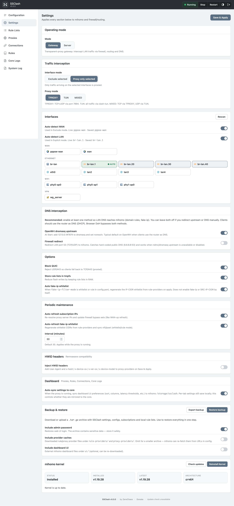
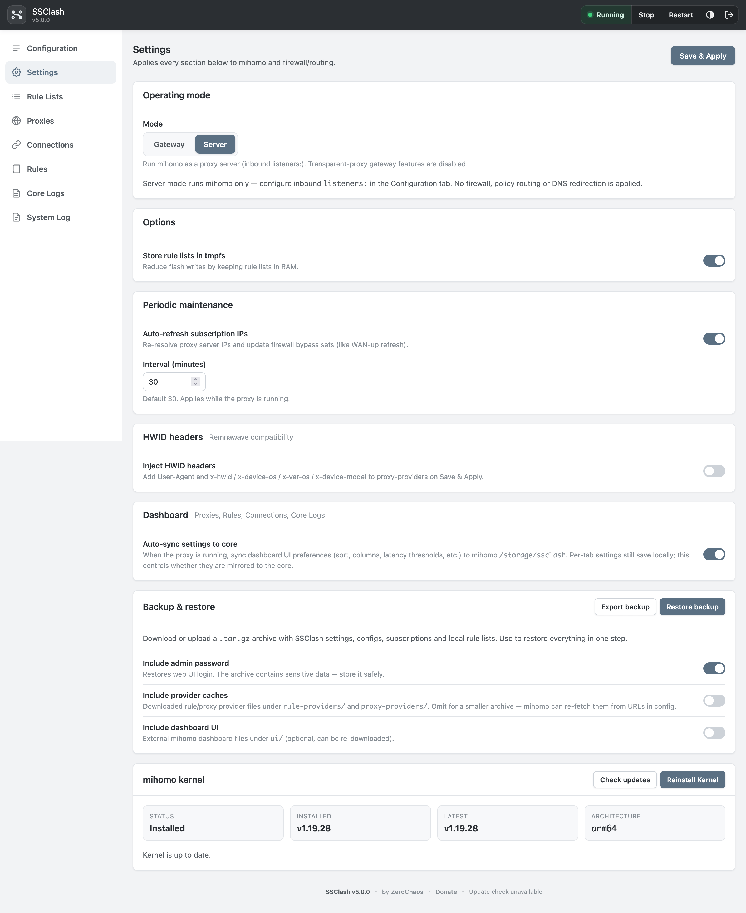
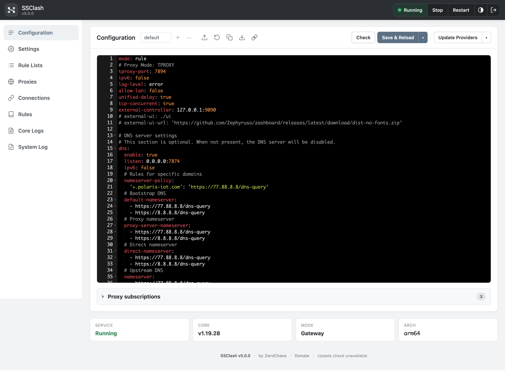
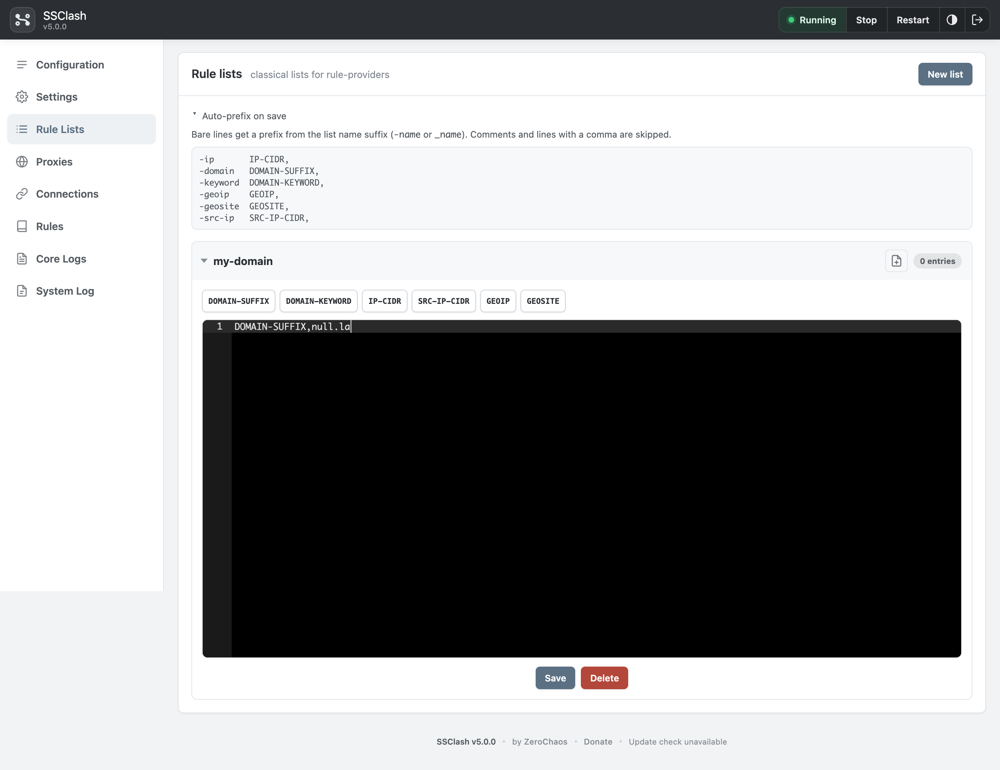
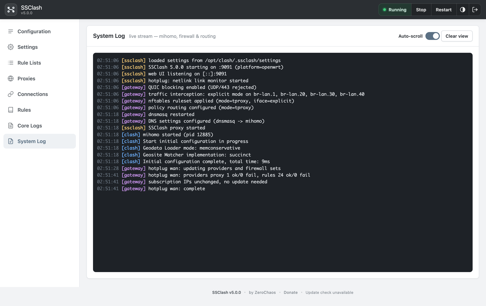
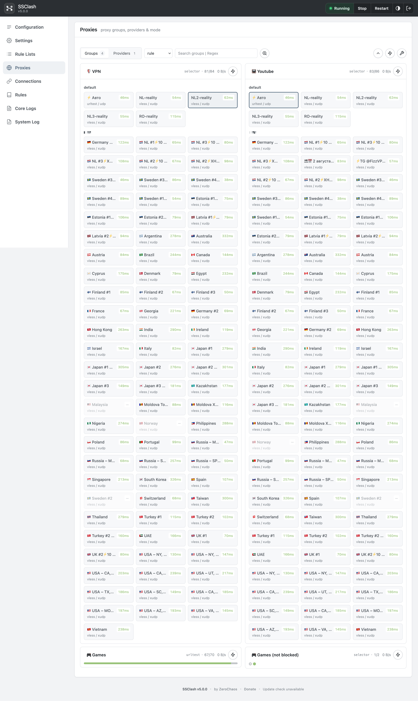
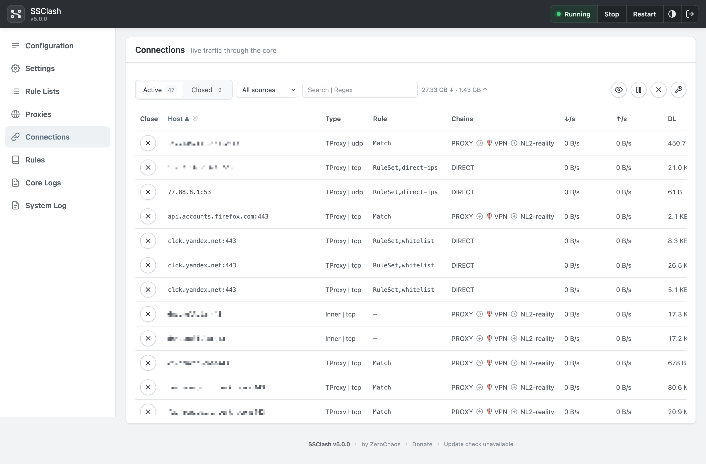
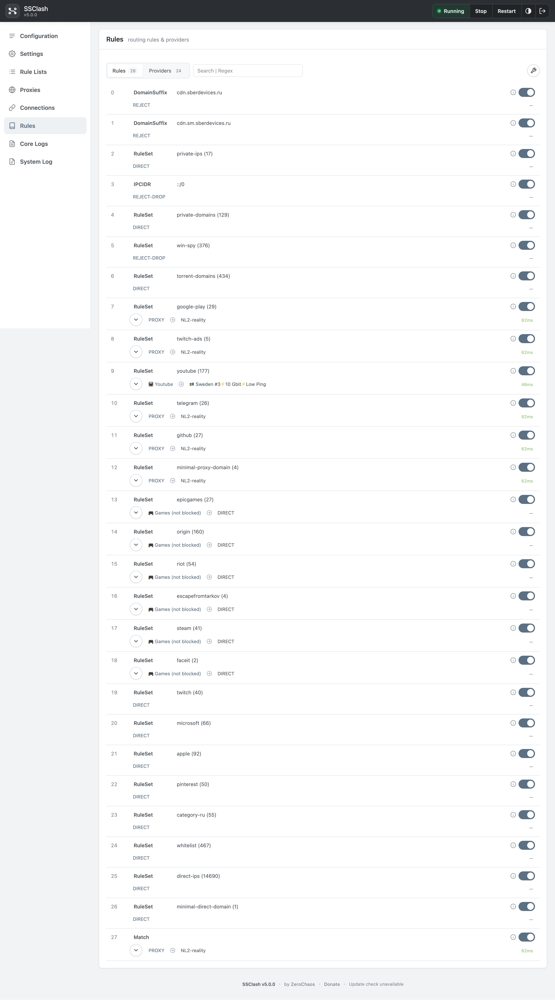
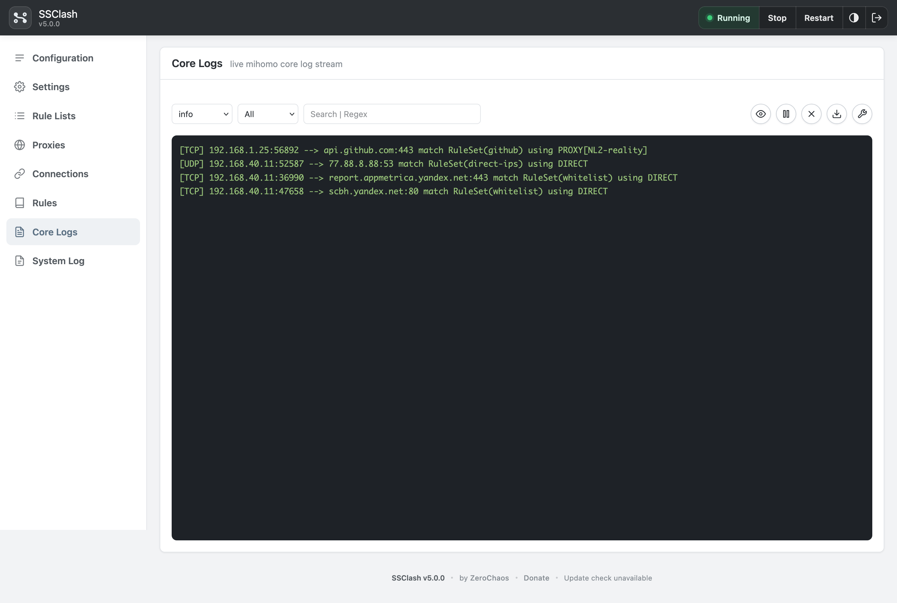

📖 Читать на других языках:
- [English](README.md)

<p align="center">
  
</p>

<p align="center"><em>Super Simple Clash — централизованный выборочный обход с Mihomo (Clash.Meta)</em></p>

<p align="center">Пошаговая инструкция по установке и настройке SSClash на роутере или Linux-шлюзе.</p>

Этот репозиторий — официальный дистрибутив **SSClash**: самодостаточный демон
со встроенным веб-интерфейсом. Пакет LuCI и OpenWrt SDK не нужны. Это преемник
оригинального LuCI-приложения
[zerolabnet/SSClash](https://github.com/zerolabnet/SSClash) с тем же каталогом
`/opt/clash` и набором функций.

## Основные возможности

- **Один бинарник, все архитектуры.** Готовые статические бинарники для amd64, arm64, armv5/6/7, 386, loong64, riscv64, ppc64le, s390x и вариантов mips/mipsle. Веб-интерфейс встроен в демон.
- **Встроенный веб-UI** — **Конфигурация**, **Настройки**, **Списки правил**, встроенная панель **Proxies / Connections / Rules / Core Logs** и **Системный лог** — редактирование YAML, управление службой, интерфейсами/ядром и потоки в реальном времени.
- **Внешнее ядро Mihomo**, полностью управляемое демоном: загрузка/обновление с GitHub Releases (архитектура определяется автоматически), запуск/остановка/перезапуск, проверка `clash -t` и горячая перезагрузка через API Mihomo.
- **Собственный движок файрвола**: атомарный ruleset `nft -f -` (`table inet clash`) или fallback iptables/ipset; режимы **TPROXY / HYBRID / TUN / MIXED / MIXED2**; модели exclude/explicit; блокировка QUIC; опциональный запрет форвардинга IPv6; опциональный kill switch, пока Mihomo не запущен; опциональная блокировка DoT/DoH при перехвате DNS Mihomo; зарезервированные сети назначения; фильтр портов; обход LAN-клиентов; оптимизация fake-ip whitelist; обход IP серверов подписок.
- **Policy routing** через `ip rule`/`ip route` (таблицы `100`/`101`, метки `0x1`/`0x2`/`0x3` на OpenWrt и Linux; на Keenetic `0x80000000`/`0x10000000` с маской `0x90000000`).
- **Безопасность по умолчанию**: пароль администратора при первом запуске (PBKDF2-HMAC-SHA256), HMAC-сессии, защита CSRF, опциональный HTTPS.
- **Платформы**: OpenWrt, обычный Linux (systemd) и Keenetic (Entware).

## Структура каталогов

По умолчанию всё находится в `/opt/clash` (переопределяется через `SSCLASH_ROOT`):

```
/opt/clash/
├── bin/ssclash          # демон SSClash
├── bin/clash            # ядро Mihomo
├── config.yaml
├── configs/             # именованные профили
├── local-rules/         # локальные списки правил (было lst/ в LuCI SSClash)
├── rule-providers/      # загруженные rule-providers (было ruleset/)
├── proxy-providers/     # загруженные proxy-providers (было proxy_providers/)
├── subscriptions/       # вставленные списки ссылок (file providers)
├── ui/                  # файлы внешней панели
├── .ssclash/            # настройки, пароль, сессия, doh-custom.txt, резерв dnsmasq (OpenWrt)
└── (runtime) /tmp/ssclash/  # кэши, tmpfs-симлинки, кэш IP подписок и списков DoH
```

### Миграция с LuCI SSClash

| LuCI SSClash | SSClash (Go) |
|---|---|
| `lst/` | `local-rules/` |
| `ruleset/` | `rule-providers/` |
| `proxy_providers/` | `proxy-providers/` |
| `settings` в корне | `.ssclash/settings` |
| `/tmp/clash/` | `/tmp/ssclash/` |

Go-версия использует тот же `config.yaml` и путь к ядру Mihomo. При обновлении на месте переименуйте каталоги по таблице выше.

# Руководство по установке

## Скрипты автоустановки

Каждый установщик загружает бинарник SSClash, настраивает `/opt/clash`, скачивает ядро Mihomo, только если этот релиз новее уже установленного, и регистрирует службу ОС. Флаг `--no-mihomo` пропускает загрузку ядра. Флаг `--update` на уже установленной системе заменяет только бинарник SSClash и Mihomo: режим, адрес, TLS и файл службы остаются прежними.

**OpenWrt** (на роутере):

```bash
wget -T 30 -qO- https://github.com/zerolabnet/SSClash-Go/raw/refs/heads/main/install-ssclash-go.sh | ash
```

Перед обновлением установщик **сам останавливает** ssclash, если служба уже запущена (чтобы скачивание с GitHub не ломалось из‑за прозрачного прокси и чтобы можно было безопасно заменить бинарники).

**Обычный Linux** (systemd):

```bash
curl -fsSL https://github.com/zerolabnet/SSClash-Go/raw/refs/heads/main/install-ssclash-go.sh | sudo sh
```

**Keenetic** (Entware по SSH от root). Встроенный BusyBox `wget` без HTTPS (часто segfault / `not an http or ftp url`). Сначала поставьте Entware `wget-ssl`:

```bash
opkg update && opkg install wget-ssl ca-certificates
export PATH="/opt/bin:/opt/sbin:$PATH"
wget -T 30 -qO- https://github.com/zerolabnet/SSClash-Go/raw/refs/heads/main/install-ssclash-go.sh | ash
```

### Параметры установки (все установщики)

| Флаг | Назначение |
|---|---|
| `--port <n>` | Порт веб-UI (по умолчанию `9091`, все интерфейсы) |
| `--bind <ip>` | Привязка веб-UI к IP (вместе с `--port`) |
| `--addr <host:port>` | Полный `SSCLASH_ADDR` (перекрывает `--port` / `--bind`) |
| `--root <path>` | Только OpenWrt — каталог установки (по умолчанию `/opt/clash`; при обновлении сохраняется, если флаг не передан) |
| `--tls-cert <path>` | TLS-сертификат (PEM); требует `--tls-key` |
| `--tls-key <path>` | TLS-ключ (PEM); требует `--tls-cert` |
| `--tls-self-signed` | Сгенерировать `$ROOT/.ssclash/tls.{crt,key}` (нужен `openssl`) |
| `--mode gateway\|server` | Только Linux — шлюз (прозрачный прокси) или сервер. В режиме server при отсутствии `config.yaml` записывается пример входящего `listeners:` |
| `--version <tag>` | Скачать конкретный релиз (по умолчанию: latest) |
| `--from <path>` | Установить локальный бинарник вместо загрузки |
| `--no-mihomo` | Пропустить загрузку ядра Mihomo (все установщики) |
| `--update` | Заменить только бинарник SSClash и Mihomo. Сохраняет режим, адрес, TLS и файл службы. Нужна уже выполненная установка. `--from`, `--version` и `--no-mihomo` допустимы. Нельзя сочетать с `--mode`, `--port`, `--bind`, `--addr`, `--root` и `--tls-*` |

Примеры:

```bash
wget -T 30 -qO- https://github.com/zerolabnet/SSClash-Go/raw/refs/heads/main/install-ssclash-go.sh | ash -s -- --no-mihomo
wget -T 30 -qO- https://github.com/zerolabnet/SSClash-Go/raw/refs/heads/main/install-ssclash-go.sh | ash -s -- --port 8443 --tls-self-signed
curl -fsSL https://github.com/zerolabnet/SSClash-Go/raw/refs/heads/main/install-ssclash-go.sh | sudo sh -s -- --from ./ssclash-linux-amd64 --mode gateway
```

Платформенные скрипты (то же поведение, длинные URL) — в `packaging/{openwrt,linux,keenetic}/`.

## Ручная установка — OpenWrt

### Шаг 1: Обновление списка пакетов

Для **OpenWrt >= 25** (apk):

```bash
apk update
```

Для **OpenWrt < 25** (opkg):

```bash
opkg update
```

### Шаг 2: Установка необходимых пакетов

При установке из GitHub Releases (не из feed) зависимости ставятся вручную:

- `kmod-tun` — режим TUN
- `kmod-nft-tproxy` — прозрачный прокси для firewall4 / nftables
- `iptables-mod-tproxy` — firewall3 / iptables (OpenWrt < 22.03)

```bash
# nftables (firewall4) на OpenWrt >= 25:
apk add kmod-tun kmod-nft-tproxy

# nftables на старых OpenWrt:
opkg install kmod-tun kmod-nft-tproxy

# iptables (firewall3):
opkg install kmod-tun iptables-mod-tproxy
```

### Шаг 3: Загрузка и установка SSClash

Выберите бинарник для вашей архитектуры в [GitHub Releases](https://github.com/zerolabnet/SSClash-Go/releases):

```bash
mkdir -p /opt/clash/bin
curl -L -o /opt/clash/bin/ssclash \
  https://github.com/zerolabnet/SSClash-Go/releases/download/v1.0.0/ssclash-linux-arm64
chmod +x /opt/clash/bin/ssclash
```

Установите init-скрипт из tarball релиза:

```bash
curl -L -o /tmp/ssclash-openwrt-service.tar.gz \
  https://github.com/zerolabnet/SSClash-Go/releases/download/v1.0.0/ssclash-openwrt-service.tar.gz
tar -xzf /tmp/ssclash-openwrt-service.tar.gz -C /
/etc/init.d/ssclash enable
/etc/init.d/ssclash start
```

### DNS на OpenWrt

На OpenWrt по умолчанию в Настройках включён **OpenWrt dnsmasq upstream** (не firewall redirect). Режимы **взаимоисключающие** — включение одного отключает другой:

- **OpenWrt dnsmasq upstream** (дефолт) — при **Start** SSClash добавляет в dnsmasq `127.0.0.1#7874`, ставит `noresolv=1` и перезагружает dnsmasq после старта Mihomo. Клиентам нужен DNS роутера (DHCP). Исходные значения uci dnsmasq сохраняются в `.ssclash/` и восстанавливаются при **Stop**.
- **Firewall redirect** — только firewall на OpenWrt (dnsmasq не меняется). Перехват LAN `:53` (TCP/UDP) в netfilter → Mihomo. Ловит «жёсткий» DNS (напр. `8.8.8.8:53`). В `config.yaml` держите `dns.listen` на `0.0.0.0:7874`. Redirect на всём LAN ingress (VLAN, порты моста); WAN исключён. При переключении с upstream снимается прежний dnsmasq upstream uci.

Переключайте режим в **Настройках** → DNS до **Start** или **Restart**.

### Блокировка DoT / DoH

Когда активен перехват DNS Mihomo (**Firewall redirect** или **OpenWrt dnsmasq upstream**), в **Настройках** → DNS доступны опции, которые режут обход DNS на LAN **до** transparent proxy / redirect:

- **Block DoT** — DROP TCP/UDP с портом назначения `853` (например Android Private DNS или фиксированный DoT-резолвер в обход DNS роутера).
- **Block known DoH (dibdot)** — DROP TCP/UDP `443` на IPv4 из списка [dibdot DoH IP blocklists](https://github.com/dibdot/DoH-IP-blocklists) (GPL-3; список скачивается при работе, кэш в tmp, ежедневное обновление). **Важно:** HTTPS на эти IP (включая `1.1.1.1` и `8.8.8.8`) с затронутых LAN-клиентов перестаёт работать. IPv6 и DoH не на порту 443 не покрываются.
- **Block DoH (custom list)** — тот же дроп `:443` для своих URL `https://host/path` (по одному на строку); хосты резолвятся в IPv4 при сохранении. Файл `.ssclash/doh-custom.txt` (входит в резервное копирование).

Правила на ingress LAN; WAN пропускается. **Обход клиентов (firewall)** не попадает под эти DROP. Сам роутер не затрагивается (нет правил OUTPUT). Только IPv4.

На бэкенде **iptables** для DoH нужен рабочий **ipset** (на OpenWrt ставится вместе с `iptables-mod-tproxy`; на Keenetic — модуль `xt_set`). Без ipset остаётся только Block DoT, в системном логе — предупреждение gateway.

Опционально **conntrack-tools** (утилита `conntrack` в PATH): сброс LAN-сессий на `:53` происходит, когда **Firewall redirect** включается или выключается, и при **Stop**, если redirect был установлен. `:853` сбрасывается только в момент включения Block DoT. Повторный Apply с теми же флагами conntrack не трогает. Repair на Keenetic сбрасывает порт только если repair реально восстановил redirect или DoT DROP, а не при одном лишь re-seat jump. **nft** и **iptables** делят один conntrack. Без пакета новые пакеты идут по новым правилам сразу, старые сессии — до таймаута; предупреждение в логе gateway — если redirect или Block DoT включены. Инсталлятор не ставит — при необходимости `opkg install conntrack-tools` (OpenWrt / Entware).

На **Keenetic TUN** эти DROP тоже работают: SSClash маркирует TCP и UDP в `clash-tun`.

Изменения переключателей применяются при **Start**, **Restart** или **Apply** файрвола. Кнопка **Refresh list** обновляет dibdot без ожидания планового refresh.

## Ручная установка — обычный Linux

Требования: systemd, `nft` или `iptables`, `ip`.

```bash
curl -fsSL https://github.com/zerolabnet/SSClash-Go/raw/refs/heads/main/install-ssclash-go.sh | sudo sh -s -- --from ./ssclash-linux-amd64 --mode gateway
```

Режим gateway применяет файрвол, policy routing и перехват DNS (зависит от платформы) при **Start** (OpenWrt: dnsmasq upstream по умолчанию; Keenetic/Linux: firewall redirect). Режим server запускает только Mihomo. Свежая установка `--mode server` записывает в `config.yaml` пример входящего `listeners:`; уже существующий файл не трогает.

## Ручная установка — Keenetic

Сначала установите Entware на USB. В веб-UI Keenetic → Компоненты включите **Open packages**, **Ext file system**, **Netfilter kernel modules** (после включения Netfilter — перезагрузка: модули ядра `xt_TPROXY` / netfilter; userspace-бинарник `iptables` **не** всегда ставится). SSClash нужен **xtables** CLI: штатный `/sbin/iptables`, если есть, иначе инсталлятор выполняет `opkg install iptables-legacy` или `opkg install iptables` (оба подходят, если `iptables -V` **не** содержит `nf_tables`). NDMS **не** API для TPROXY: он пересобирает `filter`/`nat`/`mangle` и сносит jump’ы в чужие цепочки. Официальная интеграция — хук [`/opt/etc/ndm/netfilter.d`](https://support.keenetic.com/hero/kn-1012/en/42407-opkg-component-description.html), который восстанавливает jump’ы через найденный xtables `iptables` (таймаут 24 с — хук не делает полный Apply).

Для policy routing нужен полноценный iproute2: апплет `ip` из BusyBox часто
собран без поддержки `rule`. Инсталлятор ставит `opkg install ip-full`, если `ip rule` не работает.

```bash
opkg update && opkg install wget-ssl ca-certificates
export PATH="/opt/bin:/opt/sbin:$PATH"
wget -qO- https://github.com/zerolabnet/SSClash-Go/raw/refs/heads/main/install-ssclash-go.sh | ash
```

По умолчанию: **HYBRID** + Exclude, включён **Auto fake-ip whitelist**. NAT делает KeeneticOS.
Перехват DNS по умолчанию — **Firewall redirect** в Настройках (LAN :53 → Mihomo).
Клиентам нужен DNS роутера (DHCP Keenetic).

KeeneticOS перестраивает netfilter при сохранении конфигурации, переподключении
WAN и смене компонентов, стирая переходы в цепочки SSClash. При Start ставится
хук `/opt/etc/ndm/netfilter.d/50-ssclash.sh`: он возвращает `PREROUTING -j CLASH`
(и правила DNS/QUIC) через найденный xtables `iptables`. Полный reload демона — только если
сами цепочки исчезли. Stop удаляет хук.

**Бэкенд файрвола на Keenetic** зафиксирован на **iptables** (xtables userspace, не nftables).
В Настройках нет Auto и nftables. Инсталлятор пишет `FIREWALL_BACKEND=iptables`;
Save/API приводят любое другое значение к iptables. Auto тоже разрешился бы в
iptables, но принудительный nft отвергается при Apply. Entware-сборки, где `iptables -V`
сообщает `nf_tables`, не перехватывают LAN Keenetic — нужен xtables (`/sbin/iptables`,
`iptables-legacy` или Entware `iptables`, если это xtables). Инсталлятор выполняет
`opkg install iptables-legacy` или `opkg install iptables`, если подходящего CLI нет.
Компонент **Netfilter subsystem kernel modules** всё равно нужен для модулей ядра
(`xt_TPROXY`, …). В режиме **TUN** Mihomo стартует с `DISABLE_NFTABLES=1`:
на Keenetic нет nftables для проброса LAN.

**Рекомендуемые режимы прокси на Keenetic (по порядку):** **HYBRID** (дефолт
инсталлятора — SSClash nat DNAT + TPROXY, все Options, работает при HTTPS роутера
на 443), **MIXED2** (TCP как HYBRID, UDP через `clash-tun` — лучше QUIC/UDP, без
проблемы TCP 443 TPROXY), **TPROXY** (если перенести HTTPS **управления роутером**
с TCP 443, напр. 8443, в веб-UI Keenetic), **TUN**
(SSClash маркирует TCP и UDP в `clash-tun`, как на OpenWrt).
**MIXED** (TCP TPROXY + UDP TUN) наследует ограничение Keenetic на TCP `:443` в TPROXY;
на практике редко полезен — предпочитайте **HYBRID** или **MIXED2**.

**Политики доступа Keenetic:** Настройки → **Respect Keenetic
access policy** — выбор политик с роутера (Интернет → Приоритеты подключений). SSClash
учитывает connmark NDMS в правилах файрвола: в прокси попадают только устройства,
назначенные на выбранные политики. Это работает и в **TUN**.

**RCI access token (KeeneticOS 5.2+):** С прошивки **5.2** локальный RCI на
`127.0.0.1:79` требует **RCI access token**. SSClash через RCI читает
имена политик доступа и клиентов hotspot. Настройки → **Keenetic access policy** → **RCI
access token** — создайте токен в веб-UI роутера в разделе **Users and access**, вставьте
сюда и нажмите **Save**. На KeeneticOS **до** 5.2 поле можно оставить пустым, если loopback
RCI без токена ещё работает. При недоступном или отклонённом RCI SSClash использует
`ndmc`; списки остаются, но подписи могут не совпадать с веб-UI роутера.

**TPROXY на Keenetic и TCP 443:** KeeneticOS использует порт 443 внутри `xt_TPROXY`;
LAN TCP на `:443` часто не доходит до SSClash (счётчики TPROXY остаются нулевыми).
Используйте **HYBRID** (дефолт), перенесите HTTPS управления роутером на другой порт
(напр. 8443) в веб-UI Keenetic, или **TUN**.

**Keenetic TUN** использует тот же захват, что OpenWrt и Linux: SSClash маркирует трафик в `clash-tun` (`auto-route: false`, `auto-redirect: false`). Политики доступа, обход клиентов, фильтр портов и зарезервированные сети работают. После обновления со сборки, где был Mihomo `auto-redirect`, сделайте **Stop, затем Start**.

## Режимы прокси (Настройки)

| Режим | Захват | `config.yaml` (синхронизация при Save / Start) | Примечания |
|---|---|---|---|
| **TPROXY** | SSClash mangle TPROXY `:7894` | `tproxy-port: 7894` | Дефолт на OpenWrt/Linux |
| **HYBRID** | TCP nat DNAT → `:7893`, UDP TPROXY `:7894` | `redir-port: 7893`, `tproxy-port: 7894` | Дефолт на Keenetic; все Options |
| **TUN** | MARK → `clash-tun` (OpenWrt, Linux и Keenetic) | блок `tun:` (`auto-route: false`) | TUN stack в Настройках |
| **MIXED** | TCP TPROXY, UDP MARK → `clash-tun` | `tproxy-port: 7894` + `tun:` | На Keenetic: проблема TCP `:443` TPROXY; лучше HYBRID/MIXED2 |
| **MIXED2** | TCP nat DNAT → `:7893`, UDP MARK → `clash-tun` | `redir-port: 7893` + `tun:` (без `tproxy-port`) | TCP как HYBRID + UDP как MIXED; все Options на Keenetic |

Для TUN, MIXED и MIXED2 в `tun.stack` пишется значение из Настроек: **system**, **gvisor**, **mixed** или **mips** (userspace-стек [mipstack](https://github.com/MetaCubeX/mipstack), удобен на роутерах MIPS).

При **Save** в Настройках, если proxy mode или TUN stack расходятся с активным профилем,
SSClash перезаписывает `config.yaml` (порты/блоки как в таблице), проверяет `clash -t`
и перезапускает Mihomo, если служба уже запущена.

## Шаг 4: Управление ядром Mihomo

Скрипты автоустановки скачивают последнее ядро Mihomo автоматически. На маленьком flash новое ядро заменяет старое, а не хранится второй копией; неудачное обновление удаляет `.mihomo-new.*`, а не оставляет его забивать диск. Также можно управлять из веб-UI или установить вручную (ниже).

В веб-UI: **Настройки** → **Ядро Mihomo** → **Загрузить последнее ядро**. SSClash:

- Определит архитектуру устройства
- Загрузит последний совместимый релиз Mihomo
- Установит его в `/opt/clash/bin/clash`
- Покажет статус и версию ядра

**Важно:** Перезапустите службу Clash после установки ядра.

### Ручная установка ядра (необязательно)

```bash
cd /opt/clash/bin
curl -L -o clash.gz \
  https://github.com/MetaCubeX/mihomo/releases/download/v1.19.29/mihomo-linux-arm64-v1.19.29.gz
gunzip clash.gz && chmod +x clash
```

Другие архитектуры — на [странице релизов Mihomo](https://github.com/MetaCubeX/mihomo/releases).

## Шаг 5: Режим обработки интерфейсов

SSClash предлагает два режима:

### Явный режим (рекомендуется)

- Обрабатывает трафик **только** на выбранных интерфейсах — остальное не попадает в Mihomo на уровне файрвола
- Лучший выбор, когда нужен жёсткий контроль LAN/VLAN или клиентов
- Часто используется вместе с fake-ip whitelist и правилами `SRC-IP-CIDR` в `config.yaml` (см. шаг 7)

### Режим исключения (простой вариант)

- Проксирует **весь** трафик, кроме выбранных интерфейсов (обычно WAN)
- Проще всего для «прокси на весь LAN», если не нужно делить сети
- Куда идёт трафик, по-прежнему решают правила Mihomo в `config.yaml`

### Дополнительные настройки

- **OpenWrt dnsmasq upstream** — Настройки → DNS (дефолт на OpenWrt). Направляет dnsmasq на Mihomo `:7874`; взаимоисключим с firewall redirect (см. **DNS на OpenWrt** выше).
- **Firewall redirect** — Настройки → DNS. Дефолт на Keenetic и обычном Linux; опционально на OpenWrt. Перенаправляет LAN `:53` (TCP/UDP) на Mihomo `:7874`.
- **Block DoT / Block DoH (dibdot) / Block DoH (custom)** — Настройки → DNS при активном перехвате DNS Mihomo; см. [Блокировка DoT / DoH](#блокировка-dot--doh).
- **Proxy router traffic** — Настройки → Options, только Gateway, по умолчанию выключен. Исходящий IPv4 TCP/UDP самого роутера идёт в Mihomo с теми же исключениями файрвола, что у клиентов LAN (зарезервированные сети, обход клиентов, фильтр портов, fake-ip whitelist). Политики доступа Keenetic не распространяются на собственный трафик роутера — по политике отбираются только клиенты LAN. В HYBRID и MIXED2 TCP роутера уходит DNAT на 127.0.0.1:7893, в остальных режимах пакеты маркируются. При перенаправлении DNS файрволом порт 53 самого роутера тоже уходит в Mihomo, иначе fake-ip для роутера не работает. Kill switch не применяется (это drop только форварда LAN). Выключение вступает в силу на следующем Apply.
- **Kill switch** — Настройки → Options, только Gateway, по умолчанию выключен. Пока опция включена и Mihomo не запущен, клиенты LAN не выходят в интернет: форвардинг к WAN отбрасывается. Панель, SSH и собственный трафик роутера работают. Уже существующие пробросы портов с WAN (DNAT) проходят. Если WAN известен, обмен LAN–LAN остаётся; если нет — отбрасывается весь форвардинг. Форвардинг IPv6 в этом окне тоже отбрасывается. Включение при уже работающем прокси ничего не меняет до следующего Stop. Выключение снимает запрет сразу. В режиме Server запрет не ставится. На Keenetic хук NDMS остаётся, пока опция включена. На OpenWrt include `firewall.ssclash_ks` (`/var/etc/ssclash-ks.include`) ставит запрет снова после перезагрузки firewall4. На обычном Linux запрет держится, пока его не снимет SSClash. Окно после включения роутера до старта процесса SSClash и SIGKILL до cleanup не закрываются.
- **Drop forwarded IPv6** — Настройки → Options, только Gateway, по умолчанию выключен. Отбрасывает IPv6, который роутер форвардил бы дальше, включая исключённые интерфейсы и направление WAN→LAN. Собственный IPv6 роутера остаётся. Ответы AAAA не фильтруются, форвардинг IPv6 в системе не выключается. Если нет `ip6tables`, Apply проходит, в логе gateway — предупреждение.
- **Блокировать QUIC-трафик** — блокирует UDP/443 для повышения эффективности прокси (YouTube и т.п.)
- **Зарезервированные сети (firewall)** — destination IPv4 CIDR, которые не маркируются прозрачным прокси (Настройки → Options). По умолчанию RFC special-use и CGNAT `100.64.0.0/10` (Tailscale/Headscale); уберите этот префикс, если Tailnet должен идти через Mihomo. Правила Mihomo `private-ips` — отдельно. В режимах **TPROXY**, **HYBRID** и **MIXED** в таблицу `100` дополнительно пишется scope-link маршрут каждой подключённой IPv4-сети на перехватываемом интерфейсе: поиск источника по fwmark остаётся верным, когда Tailscale ставит `src_valid_mark=1`. **TUN** и **MIXED2** эти маршруты не добавляют.
- **Фильтр портов (firewall)** — destination TCP/UDP обрабатываются в netfilter *до* Mihomo (Настройки → Options). **Bypass** никогда не попадает в ядро (например, фиксированные порты BitTorrent). **Proxy-only** (если список не пуст) помечает только перечисленные порты — удобно на слабом роутере, чтобы случайные торрент-пиры не попадали в ядро. Пустые списки сохраняют прежнее поведение «все порты». Это не то же самое, что правила Mihomo `DST-PORT`.
- **Обход клиентов (firewall)** — source IPv4 CIDR без маркировки прозрачного прокси *и* без DNS redirect, поэтому эти LAN-хосты не попадают в Mihomo (Настройки → Options). Это не `SRC-IP-CIDR` в `config.yaml` (там пакет всё равно идёт в ядро). Пустой список = off. При fake-ip укажите устройству реальный DNS. На **OpenWrt dnsmasq upstream** (дефолт) список обхода не меняет DNS для клиентов с DNS роутера — они по-прежнему идут через dnsmasq → Mihomo; задайте публичный DNS на обходимом клиенте. На **OpenWrt firewall redirect** обход отключает DNS redirect (как на Keenetic/Linux) — нужен свой DNS на клиенте.
- **Хранить правила и proxy-providers в RAM** — симлинки `rule-providers/` и `proxy-providers/` на tmpfs для снижения износа NAND
- **Добавить HWID-заголовки к подпискам** — 16-символьный HWID для Remnawave на запросах proxy-provider (также при загрузке полного конфига по URL)
- **Резервное копирование** — экспорт/импорт настроек и списков из `.ssclash/` (включая `doh-custom.txt`) на странице Настроек
- **Порт и TLS веб-UI** — через флаги установки или `SSCLASH_ADDR` / `SSCLASH_TLS_*` в init/systemd

<p align="center">
  
</p>

<p align="center">
  
</p>

## Шаг 6: Управление конфигурацией Clash

Редактируйте `config.yaml` во встроенном редакторе ACE:

- **Подсветка синтаксиса** YAML
- **Управление службой** — Запуск / Остановка / Перезапуск на панели
- **Именованные профили** — сохранение и переключение конфигов в `configs/`
- **Загрузка по URL** (опционально) — скачать полный Mihomo YAML в профиль `remote` (для Remnawave путь `/sub/{token}` повторяется как `/mihomo`). Автообновление — из `Profile-Update-Interval` провайдера или свой интервал (1–168ч); **Save settings** меняет URL/auto/interval без повторной загрузки; **Stop remote source** отписывает от URL, оставляя профиль `remote` локальной копией. Не связано с обновлением proxy-providers. Пустой URL — только локальное редактирование.
- **Отключение/включение подписок** — комментирование блоков proxy-provider без удаления
- **Open Dashboard** — открывает внешний UI Mihomo (см. шаг 9)
- **Listeners** — только режим Server. **Add listener** на странице Конфигурации собирает входящий listener Mihomo. Карточка Listeners появляется, когда listener уже есть хотя бы один. Вне режима Server кнопка и карточка скрыты.

<p align="center">
  
</p>

## Шаг 7: Управление локальными наборами правил

Создавайте и управляйте локальными файлами для `rule-providers`:

- **Пользовательские списки правил** с проверкой
- **Fake-IP whitelist** (`local-rules/fakeip-whitelist-ipcidr.txt`) — список IPv4/CIDR назначения для `fake-ip-filter-mode: whitelist` или `rule`. При включённом **Auto fake-ip whitelist** (Настройки) блок AUTO пересобирается при Start/apply из:
  - inline-правил `IP-CIDR` в `rules:` с action ≠ DIRECT (например `PROXY`, имя proxy-group)
  - IP-CIDR из rule-providers, на которые ссылаются non-DIRECT `RULE-SET`
  - записей `dns.fake-ip-filter` (по режиму фильтра)
  - `SRC-IP-CIDR` **не** копируется в этот файл — файрвол обрабатывает его отдельно для фильтрации по источнику
- После правки rules нажмите **Regenerate** на вкладке Rule Lists или **Save & Reload** / **Start**, если включена автосинхронизация
- Организованное управление файлами со сворачиваемыми разделами

<p align="center">
  
</p>

## Шаг 8: Мониторинг логов в реальном времени

Отслеживайте активность в **Системном логе**:

- **Поток SSE в реальном времени** с автоматическим обновлением
- **Цветовая кодировка источников** — `clash` (Mihomo), `gateway` (файрвол/маршрутизация/DNS), `ssclash` (демон/UI)
- Фильтр по источнику и поиск по тексту
- Автопрокрутка к последним записям

<p align="center">
  
</p>

## Шаг 9: Панель Mihomo

В SSClash встроена панель с четырьмя вкладками — **Proxies**, **Connections**, **Rules** и **Core Logs** — в том же стиле, что и остальной UI. Браузер обращается к `/api/mihomo/*`; `secret` и external controller Mihomo остаются на сервере.

**Системный лог** (в сайдбаре) — отдельно: сообщения демона SSClash, файрвола и маршрутизации. **Core Logs** — поток логов ядра Mihomo в реальном времени.

Настройки dashboard хранятся в ключах `config/*` и `cache/*` в `localStorage` браузера, с опциональной синхронизацией через слот `/storage` ядра Mihomo, если включён **Auto-sync settings** в настройках вкладки Proxies. Это не связано с файлом `cache.db` ядра (fake-ip, store-selected и т.д.).

Опционально задайте `external-ui` в `config.yaml` и установите сторонний bundle в `ui/`. При настроенном `external-ui` кнопка **Open Dashboard** на странице Конфигурации открывает внешний UI в новой вкладке.

<p align="center">
  
</p>

<p align="center">
  
</p>

<p align="center">
  
</p>

<p align="center">
  
</p>

## Первый запуск

1. Откройте `http://<host>:9091` (или ваш `--port` / `--bind` / HTTPS URL) и задайте пароль администратора.
2. Отредактируйте **Конфигурацию** — при первом запуске создаётся разумный шаблон. Добавьте прокси или подписку.
3. Нажмите **Start** на панели.

Установщик скачивает Mihomo автоматически. Если загрузка была пропущена (`--no-mihomo`) или не удалась — получите ядро в **Настройки → Ядро Mihomo** перед **Start**.

## Переменные окружения

| Переменная | По умолчанию | Назначение |
|---|---|---|
| `SSCLASH_ROOT` | `/opt/clash` | Рабочий каталог (конфиг, ядро, списки) |
| `SSCLASH_TMP` | `/tmp/ssclash` | Временный каталог (кэши, tmpfs-симлинки) |
| `SSCLASH_PLATFORM` | auto | Принудительно `openwrt`, `keenetic` или `linux` |
| `SSCLASH_ADDR` | `:9091` | Адрес прослушивания веб-UI |
| `SSCLASH_SECRET` | auto | Секрет подписи сессий (иначе сохраняется на диск) |
| `SSCLASH_TLS_CERT` / `SSCLASH_TLS_KEY` | — | HTTPS для веб-UI |
| `SSCLASH_DEBUG` | `0` | `1` — подробная диагностика boot в stderr; доп. предупреждения gateway. Полный дамп счётчиков iptables: `ssclash fw diagnose` |
| `SSCLASH_BRAND` | `SSClash` | Имя продукта в авторизованном UI |
| `SSCLASH_LOGIN_TITLE` | — | Опциональный бренд на экранах входа/настройки |

## CLI

```
ssclash [serve]              запуск демона + веб-UI (по умолчанию)
ssclash fw start|stop|update применить / снять / обновить файрвол и маршрутизацию
ssclash fw diagnose          intercept, политики, счётчики iptables (диагностика)
ssclash fw ndm-reload        восстановить jump'ы SSClash после пересборки netfilter KeeneticOS
ssclash fw sync-killswitch   поставить или снять kill switch шлюза (код 10: запрет включён)
ssclash hotplug wan|tun      обработчики WAN-up или TUN-add (вручную / cron)
ssclash cleanup              убрать сироту Mihomo и файрвол после аварийной остановки
ssclash setpass [password]   задать пароль администратора
ssclash version              вывести версию
```

## Ключевые константы

Должны совпадать с `config.yaml` (порты, метки, ID таблиц):

TPROXY порт `7894`, HYBRID TCP redirect порт `7893` (`redir-port`), DNS `7874`, external-controller `:9090`, метки `0x1`/`0x2`/`0x3` (OpenWrt и Linux), метки Keenetic `0x80000000`/`0x10000000` с маской `0x90000000`, таблицы маршрутизации `100`/`101`, приоритеты правил `1000`/`1001`, nft-таблица `inet clash`, TUN-устройство `clash-tun`, диапазон fake-ip по умолчанию `198.18.0.0/15`.

## Бинарники релизов

Каждый [GitHub Release](https://github.com/zerolabnet/SSClash-Go/releases) содержит:

| Файл | Описание |
|---|---|
| `ssclash-linux-amd64`, `ssclash-linux-arm64`, … | Статический демон (16 целей Linux) |
| `ssclash-openwrt-service.tar.gz` | Файлы службы OpenWrt `init.d` |
| `ssclash-keenetic-service.tar.gz` | Init-скрипт Keenetic Entware `S99ssclash` |
| `sha256sums.txt` | Контрольные суммы SHA-256 |

## Удаление

**OpenWrt:**

```bash
/etc/init.d/ssclash stop
/etc/init.d/ssclash disable
rm -f /etc/init.d/ssclash
rm -rf /opt/clash
```

**Linux (systemd):**

```bash
sudo systemctl stop ssclash
sudo systemctl disable ssclash
sudo rm -f /etc/systemd/system/ssclash.service
sudo rm -rf /opt/clash
```

**Keenetic:**

```bash
/opt/etc/init.d/S99ssclash stop
rm -f /opt/etc/init.d/S99ssclash
rm -f /opt/etc/ndm/netfilter.d/50-ssclash.sh
rm -rf /opt/clash
```

## Лицензия

Бинарники и скрипты установки SSClash в этом репозитории распространяются по
[проприетарной лицензии SSClash](LICENSE).

Ядро **Mihomo** — отдельный сторонний компонент со своей лицензией. См.
[THIRD_PARTY_NOTICES.md](THIRD_PARTY_NOTICES.md).

## Поддержка

Если SSClash вам полезен, можно [поддержать разработку](https://zerolab.net/donate/) — [ZeroChaos](https://zerolab.net).
