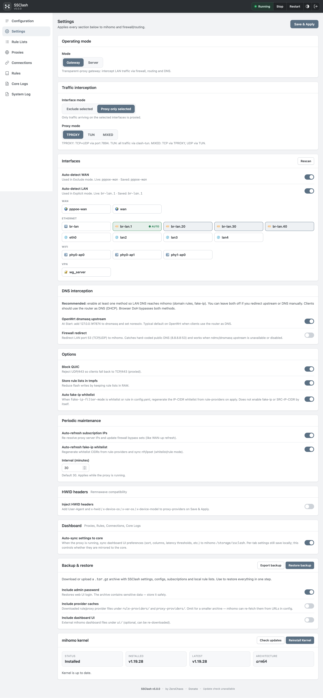
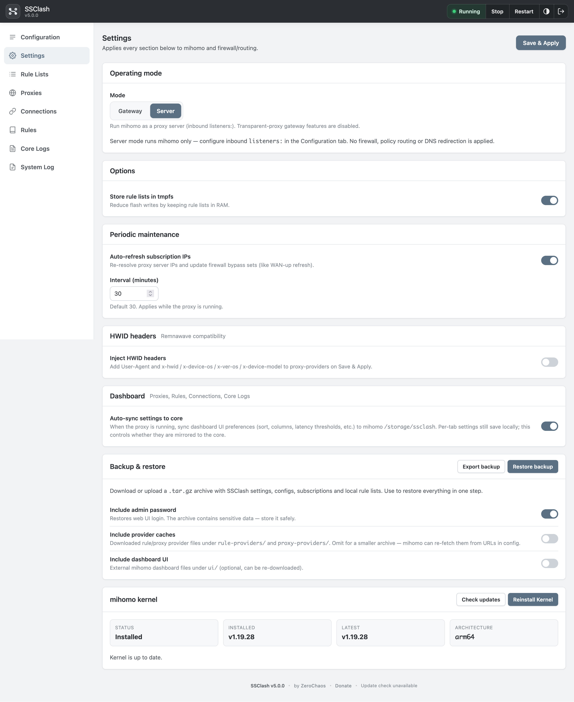
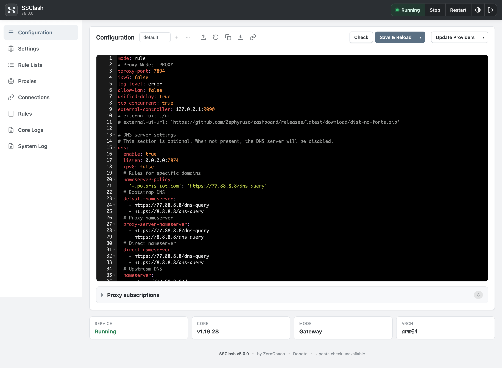
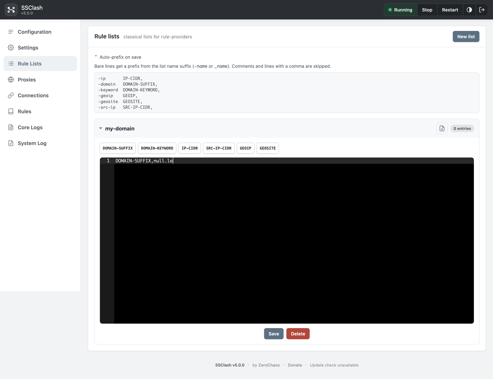
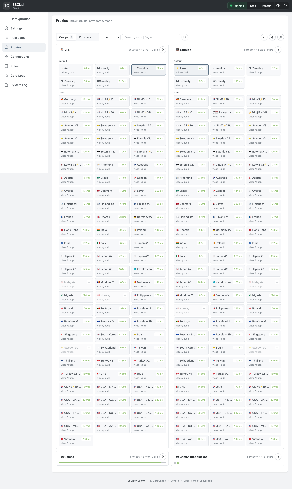
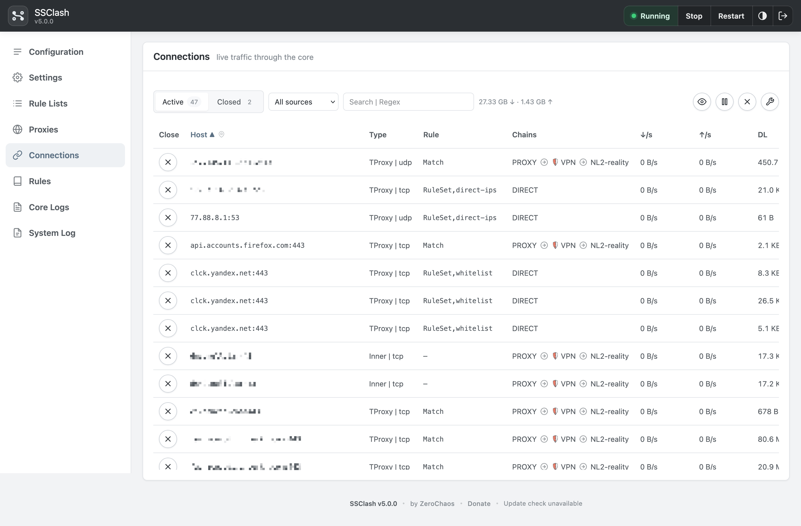
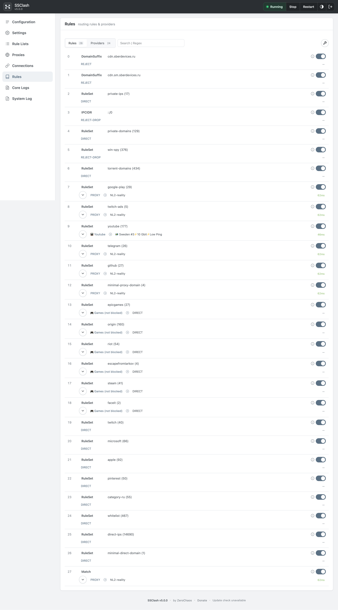
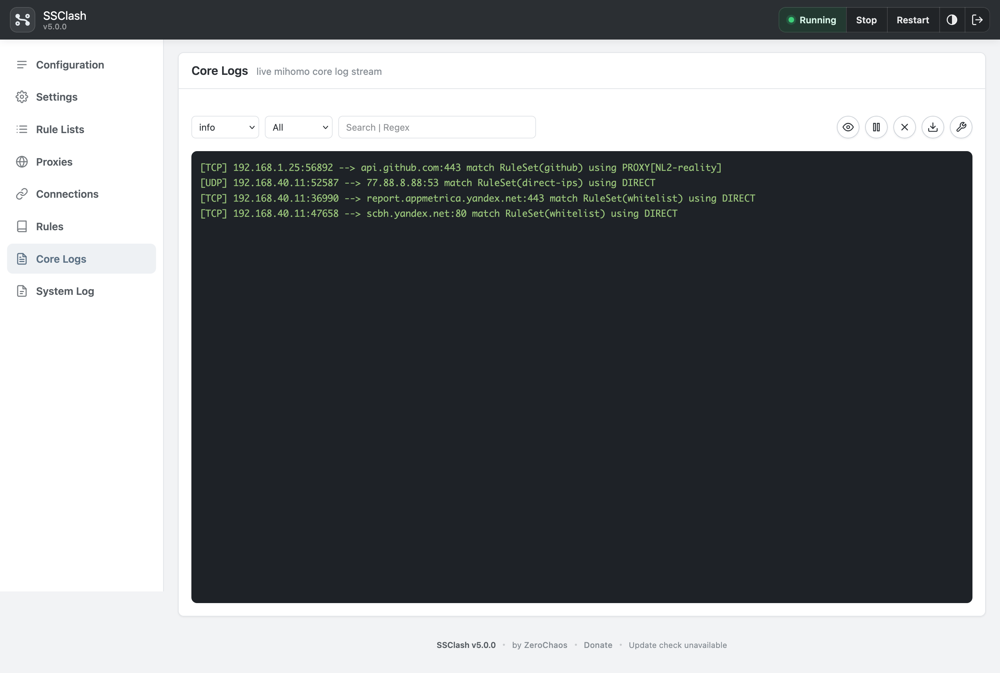
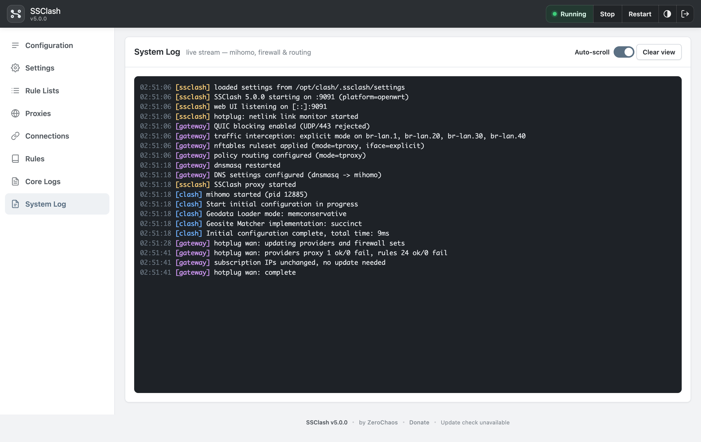

Читать на других языках:
- [English](README.md)

<p align="center">
  
</p>

<p align="center"><em>Super Simple Clash — централизованная выборочная маршрутизация и прозрачный прокси на базе Mihomo (Clash.Meta)</em></p>

**SSClash** — самодостаточная служба со встроенным веб-интерфейсом и собственной подсистемой управления правилами `firewall` и маршрутизацией по политикам для роутеров и Linux-шлюзов. Пакеты LuCI и OpenWrt SDK не требуются. Проект развивает оригинальное LuCI-приложение [zerolabnet/SSClash](https://github.com/zerolabnet/SSClash) на языке Go, сохраняя привычную структуру каталога `/opt/clash`.

---

## Содержание

- [Основные возможности](#основные-возможности)
- [Быстрый старт](#быстрый-старт)
  - [1. Установка SSClash](#1-установка-ssclash)
  - [2. Первый запуск](#2-первый-запуск)
- [Обновление SSClash и ядра Mihomo](#обновление-ssclash-и-ядра-mihomo)
  - [Обновление через веб-интерфейс (рекомендуется)](#обновление-через-веб-интерфейс-рекомендуется)
  - [Обновление через установщик (`--update`)](#обновление-через-установщик---update)
- [Типовые сценарии установки и параметры](#типовые-сценарии-установки-и-параметры)
  - [Справочник параметров установщика](#справочник-параметров-установщика)
  - [Офлайн- и ручная установка](#офлайн--и-ручная-установка)
- [Режимы работы и режимы прокси](#режимы-работы-и-режимы-прокси)
  - [Режим «Шлюз» и режим «Сервер»](#режим-шлюз-и-режим-сервер)
  - [Режимы прокси (Шлюз)](#режимы-прокси-шлюз)
  - [Особенности работы на Keenetic](#особенности-работы-на-keenetic)
- [Настройка и управление трафиком](#настройка-и-управление-трафиком)
  - [Режимы отбора интерфейсов](#режимы-отбора-интерфейсов)
  - [Перехват DNS и блокировка DoT / DoH](#перехват-dns-и-блокировка-dot--doh)
  - [Опции firewall и фильтрация трафика](#опции-firewall-и-фильтрация-трафика)
  - [Обслуживание, хранение в RAM, HWID и резервные копии](#обслуживание-хранение-в-ram-hwid-и-резервные-копии)
- [Обзор веб-интерфейса](#обзор-веб-интерфейса)
  - [Конфигурация, профили, подписки и слушатели](#конфигурация-профили-подписки-и-слушатели)
  - [Списки правил и белый список fake-ip](#списки-правил-и-белый-список-fake-ip)
  - [Встроенная панель Mihomo](#встроенная-панель-mihomo)
  - [Системный журнал](#системный-журнал)
- [Технический справочник](#технический-справочник)
  - [Структура каталогов и миграция](#структура-каталогов-и-миграция)
  - [Команды CLI](#команды-cli)
  - [Переменные окружения](#переменные-окружения)
  - [Ключевые константы и файлы релизов](#ключевые-константы-и-файлы-релизов)
- [Удаление](#удаление)
- [Лицензия и поддержка](#лицензия-и-поддержка)

---

## Основные возможности

- **Один статический исполняемый файл для всех архитектур** — готовые сборки для `amd64`, `arm64`, `armv5`/`v6`/`v7`, `386`, `loong64`, `riscv64`, `ppc64le`, `s390x` и `mips`/`mipsle` (`hardfloat` и `softfloat`). Веб-интерфейс встроен непосредственно в исполняемый файл службы.
- **Полноценный веб-интерфейс (на русском и английском языках)** — вкладки **Конфигурация**, **Настройки**, **Списки правил**, встроенная панель управления ядром (**Прокси / Соединения / Правила / Журнал ядра**) и потоковый **Системный журнал**.
- **Автоматическое управление ядром Mihomo** — определение архитектуры устройства, скачивание и обновление из GitHub Releases (каналы **Stable** и **Alpha**), проверка конфигурации командой `clash -t`, управление службой и перезагрузка конфига без разрыва соединений через API Mihomo.
- **Собственная подсистема `firewall` и маршрутизации** — атомарное применение правил `nft -f -` (таблица `inet clash`) или работа через `iptables`/`ipset`; режимы перехвата **TPROXY**, **HYBRID**, **TUN**, **MIXED** и **MIXED2**; явный режим и режим исключения интерфейсов; интеграция с политиками доступа Keenetic; блокировка QUIC и DoT/DoH; фильтр портов; клиенты в обход прокси; зарезервированные сети; метки DSCP; проксирование собственного трафика роутера; блокировка транзитного IPv6 и аварийное отключение интернета при остановке прокси.
- **Маршрутизация по политикам** — автоматическая настройка `ip rule` / `ip route` (таблицы `100`/`101`; метки `0x1`/`0x2`/`0x3` на OpenWrt и Linux, либо `0x80000000`/`0x10000000` с маской `0x90000000` на Keenetic).
- **Безопасность по умолчанию** — обязательная установка пароля администратора при первом входе (`PBKDF2-HMAC-SHA256`), подписанные `HMAC`-сессии, защита от CSRF и поддержка HTTPS (`TLS`).
- **Поддерживаемые платформы** — **OpenWrt**, **Keenetic (Entware)** и **Linux (systemd)**.

---

## Быстрый старт

### 1. Установка SSClash

Скрипт автоустановки определяет ОС и архитектуру процессора, устанавливает `/opt/clash/bin/ssclash`, скачивает актуальное ядро **Mihomo** (если оно ещё не установлено или вышла более новая версия) и регистрирует системную службу.

> [!NOTE]
> Если служба SSClash уже работает, установщик **предварительно останавливает её**, чтобы активный прозрачный прокси не мешал загрузке с GitHub и файлы можно было безопасно заменить.

#### OpenWrt

В стандартной прошивке OpenWrt уже есть `wget` (`uclient-fetch`) и оболочка `ash`. Выполните на роутере по SSH:

```bash
wget -O /tmp/install-ssclash-go.sh https://github.com/zerolabnet/SSClash-Go/raw/refs/heads/main/install-ssclash-go.sh && ash /tmp/install-ssclash-go.sh
```

#### Keenetic (Entware)

1. Разверните **Entware** на USB-накопителе.
2. В веб-интерфейсе роутера (**Общие настройки системы → Компоненты**) убедитесь, что установлены следующие компоненты, и **перезагрузите роутер** при запросе:
   - **Открытые пакеты (Entware)**
   - **Файловая система Ext**
   - **Модули ядра подсистемы Netfilter** *(необходимы для поддержки `xt_TPROXY` и модулей ядра netfilter)*
3. Подключитесь к Entware по SSH от имени `root`. Так как встроенный в прошивку BusyBox `wget` не поддерживает HTTPS (`not an http or ftp url`), установите `wget-ssl` и `ca-certificates` из Entware и запустите установщик:

```bash
opkg update && opkg install wget-ssl ca-certificates && export PATH="/opt/bin:/opt/sbin:$PATH" && wget -O /tmp/install-ssclash-go.sh https://github.com/zerolabnet/SSClash-Go/raw/refs/heads/main/install-ssclash-go.sh && ash /tmp/install-ssclash-go.sh
```

#### Linux (systemd)

Требуются `systemd`, `ip` (`iproute2`), `nft` или `iptables`, а также `curl`:

```bash
curl -fsSL -o /tmp/install-ssclash-go.sh https://github.com/zerolabnet/SSClash-Go/raw/refs/heads/main/install-ssclash-go.sh && sudo sh /tmp/install-ssclash-go.sh
```

---

### 2. Первый запуск

1. Откройте в браузере `http://<IP-роутера-или-хоста>:9091` (или указанный при установке порт / адрес HTTPS) и **задайте пароль администратора**.
   - Интерфейс доступен на **русском** и **английском** языках. Переключатель в шапке запоминает выбор (**Авто** берёт язык браузера). Смена языка перезагружает страницу, а выход из учётной записи язык не сбрасывает.
2. Перейдите на вкладку **Конфигурация** — при первом старте создаётся рабочий шаблон `config.yaml`. Добавьте подписку (**Добавить подписку**), вставьте ссылки на прокси или загрузите полный конфиг по ссылке (**Загрузить конфиг по URL**).
3. Нажмите **Запустить** на верхней панели.

> [!TIP]
> Если вы запускали установку с флагом `--no-mihomo` или скачивание ядра прервалось, перед запуском откройте **Настройки → Ядро Mihomo** и нажмите **Скачать последнее ядро**.

---

## Обновление SSClash и ядра Mihomo

### Обновление через веб-интерфейс (рекомендуется)

Обновлять и сам SSClash, и ядро Mihomo удобнее всего прямо из раздела **Настройки** без подключения по SSH:

1. **Обновление SSClash**: откройте карточку **Настройки → SSClash** (вверху страницы). Нажмите **Проверить обновления**, а затем — **Скачать обновление**. SSClash заменит `/opt/clash/bin/ssclash` и автоматически перезапустит службу. *(На системах Linux с `systemd` учётная запись службы должна иметь права на выполнение `systemctl restart ssclash.service`.)*
2. **Обновление ядра Mihomo**: откройте карточку **Настройки → Ядро Mihomo**, выберите **Канал релизов** (**Stable** — последний стабильный релиз; **Alpha** — сборки `mihomo-linux-*-alpha-*`) и нажмите **Проверить обновления** или **Скачать / обновить**.
   - На `amd64` загрузка ядра из веб-интерфейса выбирает сборку, которую процессор может выполнить: обычный файл `mihomo-linux-amd64` собран под `x86-64-v3`, а более старый процессор получает сборку `v1` или `compatible`, если такой файл есть в релизе.
   - На роутерах с небольшим объёмом флеш-памяти новое ядро распаковывается потоком сразу на место старого файла без хранения второй несжатой копии в `/tmp`, а при обрыве загрузки временный файл `.mihomo-new.*` автоматически удаляется.

### Обновление через установщик (`--update`)

Флаг `--update` обновляет **только** исполняемый файл SSClash и ядро Mihomo (если вышел более свежий релиз). Выбранный режим работы (`gateway`/`server`), адрес и порт веб-интерфейса, настройки TLS, `config.yaml` и файл службы не затрагиваются.

**OpenWrt и Keenetic (Entware):**

```bash
export PATH="/opt/bin:/opt/sbin:$PATH" && wget -O /tmp/install-ssclash-go.sh https://github.com/zerolabnet/SSClash-Go/raw/refs/heads/main/install-ssclash-go.sh && ash /tmp/install-ssclash-go.sh --update
```

**Linux (systemd):**

```bash
curl -fsSL -o /tmp/install-ssclash-go.sh https://github.com/zerolabnet/SSClash-Go/raw/refs/heads/main/install-ssclash-go.sh && sudo sh /tmp/install-ssclash-go.sh --update
```

---

## Типовые сценарии установки и параметры

Каждая команда ниже заново скачивает актуальный установщик в `/tmp/install-ssclash-go.sh` и сразу запускает его с нужными параметрами *(на Keenetic с Entware добавьте в начало строки `export PATH="/opt/bin:/opt/sbin:$PATH" && `, если `/opt/bin` ещё не стоит первым в `PATH`)*:

- **Серверный режим на VPS с Linux (`--mode server`)**
  Запускает только ядро Mihomo без правил `firewall` и маршрутизации шлюза, переносит веб-интерфейс на порт `8443` с самоподписанным сертификатом HTTPS и при первой установке добавляет в `config.yaml` шаблон входящих слушателей (`listeners:`):
  ```bash
  curl -fsSL -o /tmp/install-ssclash-go.sh https://github.com/zerolabnet/SSClash-Go/raw/refs/heads/main/install-ssclash-go.sh && sudo sh /tmp/install-ssclash-go.sh --mode server --port 8443 --tls-self-signed
  ```
- **Свой порт веб-интерфейса и HTTPS на роутере**
  Меняет порт с `9091` на `8443` и генерирует сертификат `$ROOT/.ssclash/tls.{crt,key}` (требуется пакет `openssl`):
  ```bash
  wget -O /tmp/install-ssclash-go.sh https://github.com/zerolabnet/SSClash-Go/raw/refs/heads/main/install-ssclash-go.sh && ash /tmp/install-ssclash-go.sh --port 8443 --tls-self-signed
  ```
- **Привязка веб-интерфейса только к локальному IP роутера**
  Ограничивает доступ к веб-интерфейсу конкретным адресом вместо прослушивания всех интерфейсов (`0.0.0.0`):
  ```bash
  wget -O /tmp/install-ssclash-go.sh https://github.com/zerolabnet/SSClash-Go/raw/refs/heads/main/install-ssclash-go.sh && ash /tmp/install-ssclash-go.sh --bind 192.168.1.1 --port 9091
  ```
- **Установка без скачивания ядра Mihomo (`--no-mihomo`)**
  Полезно, если вы используете собственную сборку `/opt/clash/bin/clash` или планируете скачать ядро позже через веб-интерфейс:
  ```bash
  wget -O /tmp/install-ssclash-go.sh https://github.com/zerolabnet/SSClash-Go/raw/refs/heads/main/install-ssclash-go.sh && ash /tmp/install-ssclash-go.sh --no-mihomo
  ```
- **Обновление только SSClash без обновления ядра Mihomo (`--update --no-mihomo`)**
  ```bash
  wget -O /tmp/install-ssclash-go.sh https://github.com/zerolabnet/SSClash-Go/raw/refs/heads/main/install-ssclash-go.sh && ash /tmp/install-ssclash-go.sh --update --no-mihomo
  ```

### Справочник параметров установщика

| Флаг | Назначение |
| :--- | :--- |
| `--port <n>` | Порт веб-интерфейса (по умолчанию `9091` на всех интерфейсах). |
| `--bind <ip>` | Привязка веб-интерфейса к указанному IP-адресу (используется вместе с `--port`). |
| `--addr <host:port>` | Полный адрес прослушивания `SSCLASH_ADDR` (переопределяет `--port` и `--bind`). |
| `--root <path>` | **Только OpenWrt** — каталог установки (по умолчанию `/opt/clash`; сохраняется при обновлениях, если не указан заново). |
| `--tls-cert <path>` | Путь к TLS-сертификату в формате PEM (требует `--tls-key`). |
| `--tls-key <path>` | Путь к закрытому ключу TLS в формате PEM (требует `--tls-cert`). |
| `--tls-self-signed` | Сгенерировать самоподписанный сертификат в `$ROOT/.ssclash/tls.{crt,key}` (нужен `openssl`). |
| `--mode gateway\|server` | **Только Linux** — режим работы: `gateway` (прозрачный прокси-шлюз) или `server` (сервер со входящими слушателями `listeners:`). |
| `--version <tag>` | Скачать конкретный релиз SSClash по тегу (по умолчанию — последний релиз). |
| `--from <path>` | Установить SSClash из локального исполняемого файла без скачивания с GitHub. |
| `--no-mihomo` | Не скачивать ядро Mihomo при установке или обновлении. |
| `--update` | Обновить существующую установку (заменяет только SSClash и ядро Mihomo, сохраняя режим, адрес, TLS и файл службы). Совместим с `--from`, `--version` и `--no-mihomo`. Не сочетается с `--mode`, `--port`, `--bind`, `--addr`, `--root` и `--tls-*`. |

> [!NOTE]
> Платформенные скрипты установки с тем же поведением находятся в каталогах `packaging/{openwrt,linux,keenetic}/`.

---

### Офлайн- и ручная установка

Используйте инструкции ниже, если на роутере или сервере нет прямого доступа к GitHub или репозиториям пакетов.

<details>
<summary><strong>OpenWrt — ручная и офлайн-установка / обновление</strong></summary>

#### Ручная установка на OpenWrt

1. **Обновите список пакетов:**
   ```bash
   # OpenWrt >= 25 (apk):
   apk update

   # OpenWrt < 25 (opkg):
   opkg update
   ```
2. **Установите необходимые модули ядра и пакеты:**
   - `kmod-tun` — для режимов TUN, MIXED и MIXED2
   - `kmod-nft-tproxy` — прозрачный прокси для `firewall4` / `nftables`
   - `iptables-mod-tproxy` — прозрачный прокси для `firewall3` / `iptables` (OpenWrt < 22.03)
   ```bash
   # OpenWrt >= 25 (firewall4 / nftables):
   apk add kmod-tun kmod-nft-tproxy

   # OpenWrt 22.03 – 24.x (firewall4 / nftables):
   opkg install kmod-tun kmod-nft-tproxy

   # OpenWrt < 22.03 (firewall3 / iptables):
   opkg install kmod-tun iptables-mod-tproxy
   ```
3. **Скачайте и установите исполняемый файл SSClash и скрипт службы:**
   Выберите сборку под вашу архитектуру в [GitHub Releases](https://github.com/zerolabnet/SSClash-Go/releases) и подставьте тег релиза вместо `<tag>`:
   ```bash
   mkdir -p /opt/clash/bin
   wget -O /opt/clash/bin/ssclash \
     https://github.com/zerolabnet/SSClash-Go/releases/download/<tag>/ssclash-linux-arm64
   chmod +x /opt/clash/bin/ssclash

   wget -O /tmp/ssclash-openwrt-service.tar.gz \
     https://github.com/zerolabnet/SSClash-Go/releases/download/<tag>/ssclash-openwrt-service.tar.gz
   tar -xzf /tmp/ssclash-openwrt-service.tar.gz -C /
   /etc/init.d/ssclash enable
   /etc/init.d/ssclash start
   ```

#### Офлайн-обновление на OpenWrt

> [!IMPORTANT]
> При первой установке скрипт `install-openwrt.sh` всегда обращается к репозиторию пакетов (`opkg update` / `apk update`) и останавливается, если он недоступен. Уже установленную систему можно обновить полностью офлайн.

1. Скопируйте `packaging/openwrt/install-openwrt.sh` из этого репозитория и нужный файл `ssclash-linux-*` в `/tmp/` на роутере. *(На роутере должен быть установлен `curl` или `wget-ssl`, иначе при наличии только штатного `uclient-fetch` скрипт попытается обновить индекс пакетов.)*
2. При необходимости распакуйте новое ядро Mihomo в `/opt/clash/bin/clash` (`gunzip` архива `mihomo-linux-*.gz` и `chmod 755 /opt/clash/bin/clash`).
3. Запустите обновление (скрипт службы, адрес, TLS и каталог установки сохранятся):
   ```bash
   sh /tmp/install-openwrt.sh --update --from /tmp/ssclash-linux-arm64 --no-mihomo
   ```
4. Если нужно заменить и сам init-скрипт службы:
   ```bash
   /etc/init.d/ssclash stop
   tar -xzf /tmp/ssclash-openwrt-service.tar.gz -C /
   /etc/init.d/ssclash start
   ```

</details>

<details>
<summary><strong>Keenetic (Entware) — офлайн-установка и обновление</strong></summary>

Используйте этот способ, когда с роутера нет доступа ни к GitHub, ни к репозиторию Entware. Скачайте файлы на компьютере и скопируйте их в `/tmp` на роутере по SCP или на USB-накопителе.

1. **Подберите файлы релиза под архитектуру процессора (`uname -m`):**
   - `aarch64` / `arm64` → `ssclash-linux-arm64` и `mihomo-linux-arm64-<tag>.gz`
   - `armv7l` → `ssclash-linux-armv7` и `mihomo-linux-armv7-<tag>.gz`
   - `mipsel` / `mips` → вариант `hardfloat`, если вывод `opkg print-architecture` содержит `hard`, иначе `softfloat`
   - Также скачайте `ssclash-keenetic-service.tar.gz` (содержит `opt/etc/init.d/S99ssclash`) и скрипт `packaging/keenetic/install-keenetic.sh`.
2. **Скачайте пакеты `.ipk` из репозитория Entware (включая их зависимости из поля `Depends:`):**
   - `ip-full`, `conntrack`, `ipset`
   - `iptables-legacy` (или `iptables`, если в выводе `iptables -V` нет `nf_tables`). Если в прошивке роутера уже есть `/sbin/iptables` с поддержкой `xtables`, пакет `iptables-legacy` можно пропустить.
   - *(В `PATH` должен быть доступен хотя бы встроенный BusyBox `wget` или `curl` — установщик проверяет их наличие.)*
3. **Разложите файлы и запустите установку:**
   ```bash
   mkdir -p /tmp/ssclash-offline/etc/init.d /tmp/ssclash-offline/ipk /tmp/ssclash-svc
   # Скопируйте install-keenetic.sh, файл ssclash, пакеты .ipk и ssclash-keenetic-service.tar.gz в /tmp/

   tar -xzf /tmp/ssclash-keenetic-service.tar.gz -C /tmp/ssclash-svc
   cp /tmp/ssclash-svc/opt/etc/init.d/S99ssclash /tmp/ssclash-offline/etc/init.d/

   export PATH="/opt/bin:/opt/sbin:$PATH"
   opkg install /tmp/ssclash-offline/ipk/*.ipk

   mkdir -p /opt/clash/bin
   gunzip -c /tmp/mihomo-linux-arm64-<tag>.gz > /opt/clash/bin/clash
   chmod 755 /opt/clash/bin/clash

   sh /tmp/ssclash-offline/install-keenetic.sh --from /tmp/ssclash-offline/ssclash-linux-arm64 --no-mihomo
   ```
4. **Офлайн-обновление существующей установки на Keenetic:**
   ```bash
   sh /tmp/ssclash-offline/install-keenetic.sh --update --from /tmp/ssclash-offline/ssclash-linux-arm64 --no-mihomo
   ```

</details>

<details>
<summary><strong>Linux (systemd) — офлайн-установка и обновление</strong></summary>

1. Сохраните скрипт `packaging/linux/install-linux.sh` из этого репозитория и скачайте исполняемый файл под вашу архитектуру (`x86_64` → `ssclash-linux-amd64`, `aarch64` → `ssclash-linux-arm64`). Unit-файл `systemd` формируется самим скриптом.
2. Убедитесь, что в системе установлены `ip` и `nft` либо `iptables`. В режиме шлюза скрипт также пытается установить `conntrack` и `ipset` через `apt-get` (при офлайн-установке поставьте их заранее; ошибка `apt-get` выводит только предупреждение).
3. Положите распакованное ядро Mihomo в `/opt/clash/bin/clash` (`chmod 755`).
4. **Чистая офлайн-установка:**
   ```bash
   sudo sh /tmp/install-linux.sh --from /tmp/ssclash-linux-amd64 --mode gateway --no-mihomo
   ```
5. **Офлайн-обновление существующей установки:**
   ```bash
   sudo sh /tmp/install-linux.sh --update --from /tmp/ssclash-linux-amd64 --no-mihomo
   ```

</details>

<details>
<summary><strong>Ручная установка ядра Mihomo</strong></summary>

Если вы хотите установить или обновить ядро Mihomo вручную со [страницы релизов MetaCubeX/mihomo](https://github.com/MetaCubeX/mihomo/releases), скачайте архив `mihomo-linux-<arch>-<tag>.gz`, распакуйте его в `/opt/clash/bin/clash` и сделайте исполняемым:

```bash
cd /opt/clash/bin
wget -O clash.gz \
  https://github.com/MetaCubeX/mihomo/releases/download/<tag>/mihomo-linux-arm64-<tag>.gz
gunzip clash.gz && chmod +x clash
```

После замены ядра перезапустите службу SSClash.

</details>

---

## Режимы работы и режимы прокси

### Режим «Шлюз» и режим «Сервер»

В разделе **Настройки → Режим работы** выбирается один из двух режимов:

- **Шлюз** *(по умолчанию на роутерах)* — прозрачный прокси-шлюз: перехват трафика LAN (правила `firewall`, маршрутизация по политикам и перенаправление DNS).
- **Сервер** — запускает только ядро Mihomo без правил `firewall`, маршрутизации по политикам и перенаправления DNS. На вкладке **Конфигурация** открывает визуальный конструктор входящих слушателей (**Слушатели** / `listeners:`).

### Режимы прокси (Шлюз)

При нажатии **Сохранить и применить** или **Запустить** SSClash автоматически прописывает нужные порты и блок `tun:` в активный `config.yaml`, проверяет его командой `clash -t` и применяет правила `firewall` и маршрутизации:

| Режим | Схема перехвата трафика | `config.yaml` (автосинхронизация) | Назначение и особенности |
| :--- | :--- | :--- | :--- |
| **TPROXY** | `mangle` TPROXY на порт `:7894` (TCP и UDP) | `tproxy-port: 7894` | **По умолчанию на OpenWrt и Linux.** Работает на метках маршрутизации по политикам без интерфейса `clash-tun`. |
| **HYBRID** | TCP через `nat` DNAT → `127.0.0.1:7893`; UDP через TPROXY `:7894` | `redir-port: 7893`, `tproxy-port: 7894` | **По умолчанию на Keenetic.** Поддерживает все опции `firewall` SSClash и не конфликтует с HTTPS роутера на порту 443. |
| **TUN** | По метке пакета (`fwmark`) → интерфейс `clash-tun` (TCP и UDP) | блок `tun:` (`auto-route: false`, `auto-redirect: false`) | Полноценный туннель третьего уровня (L3) на OpenWrt, Linux и Keenetic. Выбор стека TUN в настройках. |
| **MIXED** | TCP через TPROXY `:7894`; UDP через `clash-tun` | `tproxy-port: 7894` + `tun:` | Раздельная схема, если TPROXY плохо справляется с UDP/QUIC. *(На Keenetic наследует ограничение TPROXY на порту 443 — лучше выбрать **MIXED2**.)* |
| **MIXED2** | TCP через `nat` DNAT → `127.0.0.1:7893`; UDP через `clash-tun` | `redir-port: 7893` + `tun:` *(без `tproxy-port`)* | **Оптимально для Keenetic при активном UDP/QUIC:** сочетает TCP из HYBRID со стабильной работой UDP через `clash-tun`. |

**Стек TUN (`tun.stack`):** для режимов **TUN**, **MIXED** и **MIXED2** в настройках доступен выбор сетевого стека:
- **`system`** *(по умолчанию)* — сетевой стек ядра ОС; обеспечивает лучшую производительность на Linux и OpenWrt.
- **`gvisor`** — сетевой стек в пространстве пользователя; попробуйте его, если `system` работает нестабильно.
- **`mixed`** — системный стек для TCP и стек `gvisor` для UDP.
- **`mips`** — стек в пространстве пользователя на чистом Go ([mipstack](https://github.com/MetaCubeX/mipstack)); предназначен для роутеров MIPS, где `system` и `gvisor` недоступны или работают нестабильно.

---

### Особенности работы на Keenetic

- **Рекомендуемые режимы прокси на Keenetic (по убыванию):**
  1. **HYBRID** *(выбор установщика по умолчанию)* — работают все функции `firewall` SSClash (клиенты в обход прокси, фильтр портов, зарезервированные сети, политики доступа Keenetic), веб-интерфейс роутера по HTTPS на порту TCP 443 не блокируется.
  2. **MIXED2** — TCP через DNAT (как в HYBRID), а UDP через `clash-tun` для более стабильной работы QUIC и UDP без конфликта на порту 443.
  3. **TPROXY** — работает, только если предварительно перенести HTTPS управления роутером в настройках Keenetic с порта TCP `443` на другой порт (например, `8443`).
  4. **TUN** — SSClash направляет TCP и UDP по метке в интерфейс `clash-tun` (как на OpenWrt). Работают клиенты в обход прокси, фильтр портов, зарезервированные сети и политики доступа. *(После обновления со старой сборки, использовавшей `auto-redirect` в Mihomo, нажмите **Остановить**, а затем **Запустить**.)*
- **Политика доступа Keenetic:** в разделе **Настройки → Политика доступа Keenetic** включите **Учитывать политику доступа Keenetic** и отметьте нужные политики, созданные в веб-интерфейсе роутера (**Интернет → Политики доступа**). SSClash проверяет метки соединения NDMS `connmark`, направляя в Mihomo только трафик устройств из выбранных политик (работает во всех режимах, включая **TUN**).
- **Токен доступа RCI (KeeneticOS 5.2+):** начиная с KeeneticOS 5.2 для работы фильтрации по политикам и получения точных названий политик и клиентов через локальный RCI (`127.0.0.1:79`) требуется токен. Создайте его в веб-интерфейсе роутера в разделе **Пользователи и доступ**, вставьте в поле **Токен доступа RCI** и нажмите **Сохранить и применить**.

<details>
<summary><strong>Технические детали Keenetic (iptables, хук NDMS netfilter.d, порт TCP 443)</strong></summary>

- **Фиксированный бэкенд `iptables` (`xtables`):** в ядре KeeneticOS нет поддержки `nftables` для маршрутизации трафика LAN. Поэтому на Keenetic всегда используется `iptables` (`xtables`), а в режиме TUN Mihomo запускается с `DISABLE_NFTABLES=1`. Сборки из Entware, работающие только через `nf_tables` (в выводе `iptables -V` указано `nf_tables`), не могут перехватывать трафик LAN и отклоняются при запуске — используется штатный `/sbin/iptables` из прошивки либо пакет `iptables-legacy` / `iptables` (`xtables`).
- **Полноценный `iproute2` (`ip-full`):** урезанный апплет `ip` из BusyBox не поддерживает `ip rule`. Если команда `ip rule` недоступна, установщик автоматически ставит пакет `ip-full`.
- **Автовосстановление правил через хук NDMS (`/opt/etc/ndm/netfilter.d/50-ssclash.sh`):** KeeneticOS пересобирает таблицы `filter`/`nat`/`mangle` при каждом сохранении настроек роутера и переподключении WAN, сбрасывая переходы в цепочки SSClash. При запуске SSClash устанавливает скрипт в `/opt/etc/ndm/netfilter.d/50-ssclash.sh` (таймаут 24 с), который мгновенно возвращает переходы `PREROUTING -j CLASH` и правила DNS/QUIC, а полную перезагрузку выполняет только в случае удаления самих пользовательских цепочек.
- **Ограничение TPROXY на порту TCP 443:** KeeneticOS внутренне задействует порт 443 для `xt_TPROXY`, когда HTTPS веб-интерфейса роутера висит на порту 443. Из-за этого в режимах `TPROXY` и `MIXED` пакеты HTTPS из LAN на порт 443 не доходят до Mihomo (счётчики TPROXY остаются нулевыми). Режимы **HYBRID**, **MIXED2** и **TUN** (либо перенос HTTPS роутера на порт `8443`) полностью обходят это ограничение.

</details>

---

## Настройка и управление трафиком

### Режимы отбора интерфейсов

В разделе **Настройки → Перехват трафика → Режим интерфейсов** доступны два варианта:

- **Явный режим (`Проксировать только выбранные` — рекомендуется)**
  В Mihomo направляется трафик **только** с отмеченных интерфейсов (например, одного моста LAN или отдельного VLAN) — остальной трафик отсекается ещё на уровне `firewall`. Кнопка **Автоопределение LAN** автоматически добавляет основной локальный интерфейс.
- **Режим исключения (`Исключить выбранные` — простой вариант по умолчанию)**
  Работает как шлюз для всей локальной сети: перехватывается весь трафик, кроме отмеченных интерфейсов (обычно WAN). Кнопка **Автоопределение WAN** автоматически добавляет найденный интерфейс WAN в список обхода.
- **Бэкенд firewall (`Авто` / `nftables` / `iptables`)**
  На OpenWrt и Linux в разделе **Настройки → Перехват трафика** можно выбрать **Авто** (использует `nftables` и таблицу `inet clash`, если утилита `nft` поддерживается ядром, иначе — `iptables`), либо принудительно зафиксировать **nftables** или **iptables**. На Keenetic всегда используется **iptables** (`xtables`).

---

### Перехват DNS и блокировка DoT / DoH

Для корректной работы доменных правил (`DOMAIN-SUFFIX`, `GEOSITE`) и режима `fake-ip` запросы DNS от клиентов LAN должны поступать в Mihomo (`:7874`), а клиенты должны получать роутер как DNS-сервер по DHCP.

#### Способы перехвата DNS

- **Вышестоящий dnsmasq на OpenWrt** *(по умолчанию на OpenWrt)* — при запуске SSClash добавляет `127.0.0.1#7874` в `dnsmasq` и включает `noresolv=1` (исходные настройки UCI сохраняются в `.ssclash/` и восстанавливаются при остановке).
- **Перенаправление через firewall** *(по умолчанию на Keenetic и Linux; опционально на OpenWrt)* — перенаправляет обращения из LAN на порт `53` (TCP/UDP) в Mihomo (`:7874`) средствами `firewall`, не меняя конфигурацию `dnsmasq`. Дополнительно перехватывает обращения к жёстко прописанным на устройствах внешним DNS-серверам (например, `8.8.8.8:53`). В `config.yaml` оставьте `dns.listen: 0.0.0.0:7874`. *(На OpenWrt оба режима взаимоисключающие.)*

#### Блокировка шифрованного DNS в обход прокси (DoT / DoH)

Запросы DNS-over-TLS (DoT) и DNS-over-HTTPS (DoH) идут мимо обычного порта `53` и `dnsmasq`. Когда перехват DNS включён, в разделе **Настройки → Перехват DNS** можно активировать блокировку обходных путей до прозрачного прокси:

- **Блокировать DoT (порт 853)** — отбрасывает пакеты TCP/UDP на порт `853` из LAN, чтобы функция Private DNS в Android или сторонние DoT-клиенты переключались на обычный DNS через Mihomo.
- **Блокировать известные DoH (dibdot)** — отбрасывает пакеты TCP/UDP на порт `443` к IPv4-адресам публичных DoH-серверов из списка [dibdot DoH IP blocklists](https://github.com/dibdot/DoH-IP-blocklists) (скачивается при работе и обновляется раз в сутки).
  > [!WARNING]
  > При включении этой опции у фильтруемых клиентов LAN перестанет открываться прямой HTTPS по IP-адресам из списка (включая `https://1.1.1.1/` и `https://8.8.8.8/`).
- **Блокировать DoH (свой список)** — аналогичная блокировка порта `443` для вашего списка адресов `https://host/path` (хранится в `.ssclash/doh-custom.txt`; при сохранении доменные имена преобразуются в IPv4-адреса).

> [!NOTE]
> - Блокировка DoT и DoH действует только на IPv4-трафик из LAN; трафик самого роутера и **Клиентов в обход прокси (firewall)** не блокируется.
> - На бэкенде `iptables` для блокировки списков DoH требуется рабочий `ipset` (устанавливается с `iptables-mod-tproxy` на OpenWrt; на Keenetic работает через `xt_set`).
> - При наличии утилиты `conntrack` (`conntrack-tools`) SSClash автоматически сбрасывает активные сессии LAN на порт `53` при переключении перенаправления DNS и на порт `853` при включении блокировки DoT, чтобы правила применились мгновенно.

---

### Опции firewall и фильтрация трафика

Настройки ниже находятся в разделе **Настройки → Опции** (режим «Шлюз»):

| Опция | Назначение и принцип работы |
| :--- | :--- |
| **Блокировать QUIC** | Отклоняет пакеты `UDP/443` из LAN, чтобы браузеры и приложения переходили на `TCP/443` через прокси (улучшает проксирование YouTube и сайтов на HTTP/3). |
| **Клиенты в обход прокси (firewall)** | IPv4-адреса и подсети CIDR источников, трафик которых не помечается для прозрачного прокси и не попадает под перенаправление DNS через `firewall` во всех режимах перехвата (включая TUN). Проверяется раньше политик доступа Keenetic и не зависит от правил `SRC-IP-CIDR` в `config.yaml`. *(При использовании `fake-ip` пропишите на таком устройстве публичный DNS вручную или через резервацию DHCP, особенно на OpenWrt с общим `dnsmasq`.)* |
| **Фильтр портов (firewall)** | Обрабатывает порты назначения TCP/UDP в netfilter ещё *до* Mihomo:<br>• **Порты назначения в обход прокси** — трафик на эти порты не попадает в ядро (кнопка **Обход торрента** добавляет стандартный диапазон BitTorrent).<br>• **Только указанные порты назначения (в прокси)** — помечает для проксирования только перечисленные порты. На слабом роутере нажмите **Только типовые порты** (`80, 443, …`), чтобы пиры BitTorrent на случайных верхних портах не нагружали ядро. *(Если заполнены оба списка, приоритет у обхода.)* |
| **Зарезервированные сети (firewall)** | Адреса и подсети назначения, которые не помечаются для прозрачного прокси. По умолчанию включают служебные диапазоны RFC и подсеть CGNAT `100.64.0.0/10` (**Tailscale / Headscale CGNAT** — удалите её из списка, если трафик Tailnet должен идти через Mihomo; правила `private-ips` в самом Mihomo настраиваются отдельно). *(В режимах **TPROXY**, **HYBRID** и **MIXED** в таблицу `100` дополнительно прописывается маршрут `scope-link` для каждой подключённой подсети IPv4 на перехватываемом интерфейсе, чтобы проверка обратного маршрута по `fwmark` работала при `src_valid_mark=1` в Tailscale; в **TUN** и **MIXED2** такие маршруты не добавляются.)* |
| **Проксировать трафик роутера** | Направляет собственный исходящий трафик TCP/UDP роутера (цепочка `OUTPUT`) в Mihomo с теми же исключениями `firewall`, что и у клиентов LAN. *(Политики доступа Keenetic и аварийное отключение на сам роутер не распространяются.)* |
| **Метки DSCP (firewall)** | Фильтрация по значению поля DSCP в IP-пакетах, заданному в ОС или приложении на клиенте:<br>• **Обход по DSCP** (напр. `62`) — пакеты обходят перехват трафика, перенаправление DNS через `firewall`, а также блокировку QUIC и DoT/DoH.<br>• **Принудительно в прокси по DSCP** (напр. `63`) — направляет трафик в прокси в обход отбора по интерфейсам, политик Keenetic, фильтрации адресатов `fake-ip` и фильтра портов (блокировка QUIC и DoT/DoH при этом сохраняется). |
| **Блокировать транзитный IPv6** | Блокирует пересылку транзитного IPv6-трафика клиентов LAN, чтобы клиенты работали по IPv4 через Mihomo. На самом роутере IPv6 сохраняется. |
| **Аварийное отключение (Kill switch)** | Пока прокси остановлен, блокирует доступ в интернет (транзитный трафик к WAN) для клиентов LAN. Веб-интерфейс, SSH, собственный трафик роутера, локальная сеть LAN–LAN и пробросы портов с WAN остаются доступны. Сохраняется при перезагрузке `fw4` на OpenWrt (`/var/etc/ssclash-ks.include`) и пересборке netfilter на Keenetic. |

---

### Обслуживание, хранение в RAM, HWID и резервные копии

- **Автоматический белый список fake-ip и хранение списков в tmpfs (RAM):**
  - **Автоматический белый список fake-ip** при запуске и применении настроек пересобирает блок `AUTO` в файле `local-rules/fakeip-whitelist-ipcidr.txt` из встроенных правил `IP-CIDR`, ведущих в прокси или группу прокси, записей `IP-CIDR` из провайдеров правил, на которые ссылаются такие правила, и записей `dns.fake-ip-filter` (когда `fake-ip-filter-mode` равен `whitelist` или `rule`). Подробнее см. в разделе [Списки правил и белый список fake-ip](#списки-правил-и-белый-список-fake-ip).
  - **Хранить списки правил в tmpfs** переносит `rule-providers/` и `proxy-providers/` через символьные ссылки в оперативную память (`/tmp/ssclash`), снижая износ флеш-памяти роутера.
- **Периодическое обслуживание:**
  - **Автообновление IP-адресов подписок** — периодически заново определяет IP-адреса прокси-серверов и обновляет списки обхода в `firewall` (аналогично обновлению при поднятии интерфейса WAN).
  - **Автообновление белого списка fake-ip** — пока прокси работает, периодически пересобирает подсети CIDR белого списка и синхронизирует наборы `nft`/`ipset` (по умолчанию раз в `30` минут, диапазон `5–1440`).
- **Совместимость с Remnawave (`Подставлять заголовки HWID`):**
  - Автоматически добавляет заголовки `User-Agent`, `x-hwid` (16-символьный MD5 от MAC-адреса LAN или заданный вручную), `x-device-os`, `x-ver-os` и `x-device-model` при обновлении `proxy-providers` и скачивании удалённого конфига по URL.
- **NAT masquerade на WAN *(только Linux-шлюз)*:**
  - Добавляет временное правило `MASQUERADE` для клиентов LAN, использующих этот Linux-хост как шлюз по умолчанию, не изменяя системные файлы в `/etc`.
- **Резервная копия:**
  - Экспорт и восстановление всех настроек SSClash, профилей конфигурации, подписок, списка DoH и локальных списков правил одним архивом `.tar.gz` (с возможностью включить в архив пароль администратора, файлы внешней панели `ui/` и кэши провайдеров).

<details>
<summary><strong>Скриншоты: Настройки (режимы «Шлюз» и «Сервер»)</strong></summary>

<p align="center">
  
</p>

<p align="center">
  
</p>

</details>

---

## Обзор веб-интерфейса

### Конфигурация, профили, подписки и слушатели

На вкладке **Конфигурация** расположен редактор `config.yaml` с быстрым переходом по разделам и управлением подписками:

- **Именованные профили** — создание, дублирование, переименование, переключение и удаление профилей в папке `configs/`.
- **Подписки прокси** — добавление HTTPS URL подписок или вставка списков ссылок (`vless://`, `vmess://`, `trojan://`, `ss://`, `ssr://`, `hysteria2://`, `tuic://`, `anytls://`, `mieru://`, `socks5://`). Подписки можно временно выключать (блок комментируется в YAML) и обновлять через API Mihomo без разрыва активных соединений.
- **Загрузка полного конфига по URL (`профиль remote`)** — скачивает готовый YAML-конфиг Mihomo в профиль `remote` (пути Remnawave вида `/sub/{token}` автоматически дозапрашиваются как `/sub/{token}/mihomo`) с поддержкой автообновления по `Profile-Update-Interval` провайдера или фиксированному интервалу (`1–168` ч).
- **Входящие слушатели (`Слушатели`, только в режиме «Сервер»)** — кнопка **Добавить слушатель** на верхней панели открывает конструктор входящего слушателя Mihomo (запись в `listeners:`); карточка **Слушатели** появляется, когда создан хотя бы один слушатель.

<details>
<summary><strong>Скриншот: Редактор конфигурации</strong></summary>

<p align="center">
  
</p>

</details>

---

### Списки правил и белый список fake-ip

Вкладка **Списки правил** предназначена для работы с локальными списками в `local-rules/`, подключаемыми через `rule-providers`:

- **Автопрефикс при сохранении** — строки без префикса автоматически дополняются префиксом правила Clash по суффиксу имени списка (`-domain`, `-keyword`, `-ip`, `-src-ip`, `-geoip`, `-geosite`).
- **Быстрое добавление в конфиг** — кнопка **Добавить в конфиг** сразу прописывает список как `rule-provider` в `config.yaml`.
- **Белый список fake-ip (`local-rules/fakeip-whitelist-ipcidr.txt`)**:
  - **Состав блока `AUTO`** — сюда попадают встроенные правила `IP-CIDR`, действие которых ведёт в прокси или в группу прокси (`DIRECT`, `REJECT`, `REJECT-DROP` и `PASS` не попадают; IPv6 и `SRC-IP-CIDR` не попадают), записи `IP-CIDR` из провайдеров правил (`rule-providers`), на которые ссылаются такие правила, и записи `dns.fake-ip-filter`. Это реальные IPv4-адреса и подсети назначения: им выдаётся настоящий IP-адрес, а не `fake-ip`, при этом `firewall` всё равно направляет трафик к ним в ядро Mihomo.
  - **Сохранение и пересборка** — сохранение файла белого списка записывает текст как есть и, если прокси запущен, обновляет набор в ядре без пересборки блока `AUTO`. Пересборка блока `AUTO` выполняется кнопкой **Пересобрать** (`Regenerate`), а также при запуске и применении настроек, когда включён **Автоматический белый список fake-ip**. Ручные строки вне маркеров `AUTO` при пересборке сохраняются, а правки внутри маркеров сохраняются до следующей пересборки.
  - **Индикатор выполнения** — пока список собирается или загружается в ядро, под шапкой остаётся полоса с уведомлением, что обработка большого списка сетей может занять несколько минут (это не всплывающее уведомление). Строки системного журнала об этой работе остаются на английском языке.

<details>
<summary><strong>Скриншот: Списки правил</strong></summary>

<p align="center">
  
</p>

</details>

---

### Встроенная панель Mihomo

В SSClash встроена панель управления Mihomo с четырьмя вкладками — **Прокси**, **Соединения**, **Правила** и **Журнал ядра**:

- **Безопасная работа через сервер** — браузер обращается только к `/api/mihomo/*` в рамках авторизованной сессии SSClash; открывать `external-controller` (`:9090`) и `secret` наружу не требуется.
- **Синхронизация настроек интерфейса** — параметры отображения (сортировка, столбцы таблицы соединений, пороги задержки) сохраняются в `localStorage` браузера и при включённой опции **Автосинхронизация настроек с ядром** дублируются в ядро Mihomo по пути `/storage/ssclash`.
- **Поддержка внешней панели (`external-ui`)** — если в `config.yaml` задан параметр `external-ui` и в папке `ui/` установлена сторонняя панель, кнопка **Открыть панель** на вкладке «Конфигурация» откроет её в новой вкладке браузера.

<details>
<summary><strong>Скриншоты: Прокси, Соединения, Правила и Журнал ядра</strong></summary>

<p align="center">
  
</p>

<p align="center">
  
</p>

<p align="center">
  
</p>

<p align="center">
  
</p>

</details>

---

### Системный журнал

Вкладка **Системный журнал** в реальном времени (через SSE) отображает события всех подсистем с цветовой маркировкой источников:
- `clash` — вывод ядра Mihomo
- `gateway` — работа правил `firewall`, маршрутизации по политикам, перехвата DNS и обработчиков `hotplug`
- `ssclash` — события самой службы и веб-интерфейса

<details>
<summary><strong>Скриншот: Системный журнал</strong></summary>

<p align="center">
  
</p>

</details>

---

## Технический справочник

### Структура каталогов и миграция

По умолчанию все файлы располагаются в `/opt/clash` (путь переопределяется переменной `SSCLASH_ROOT`):

```text
/opt/clash/
├── bin/ssclash              # Исполняемый файл службы SSClash
├── bin/clash                # Исполняемый файл ядра Mihomo
├── config.yaml              # Активный файл конфигурации
├── configs/                 # Именованные профили конфигурации
├── local-rules/             # Локальные списки правил (бывшая папка lst/ в LuCI SSClash)
├── rule-providers/          # Скачанные файлы провайдеров правил (бывшая ruleset/)
├── proxy-providers/         # Скачанные файлы провайдеров прокси (бывшая proxy_providers/)
├── subscriptions/           # Сохранённые списки вставленных ссылок (file providers)
├── ui/                      # Файлы внешней веб-панели (необязательно)
├── .ssclash/                # Настройки, хеш пароля, ключ сессий, doh-custom.txt, резервная копия UCI
└── (runtime) /tmp/ssclash/  # Временные кэши, ссылки tmpfs, определённые IP подписок и DoH
```

<details>
<summary><strong>Миграция с классического LuCI SSClash</strong></summary>

Версия на Go использует тот же файл `/opt/clash/config.yaml` и тот же путь к ядру `/opt/clash/bin/clash`. При обновлении поверх старой версии переименуйте каталоги согласно таблице:

| LuCI SSClash | SSClash (Go) |
| :--- | :--- |
| `lst/` | `local-rules/` |
| `ruleset/` | `rule-providers/` |
| `proxy_providers/` | `proxy-providers/` |
| `settings` (в корне) | `.ssclash/settings` |
| `/tmp/clash/` | `/tmp/ssclash/` |

</details>

---

### Команды CLI

```text
ssclash [serve]              Запуск службы и веб-интерфейса (по умолчанию)
ssclash fw start|stop|update Применить, снять или обновить правила firewall и маршрутизацию
ssclash fw validate-policy   Проверить правила и таблицы маршрутизации по политикам
ssclash fw repair-policy     Восстановить правила и таблицы маршрутизации по политикам
ssclash fw validate-forward  Проверить правила пересылки (forwarding) в firewall
ssclash fw repair-forward    Восстановить правила пересылки в firewall
ssclash fw ndm-reload        Восстановить переходы SSClash после пересборки netfilter в KeeneticOS
ssclash fw sync-killswitch   Установить или снять правила аварийного отключения (код 10 = блокировка активна)
ssclash fw diagnose          Вывести диагностику перехвата, политик и счётчиков iptables
ssclash hotplug wan|tun      Запустить обработчики поднятия WAN или добавления интерфейса TUN
ssclash cleanup              Остановить зависший процесс Mihomo и очистить правила firewall после сбоя
ssclash setpass [password]   Задать или сбросить пароль администратора веб-интерфейса
ssclash version              Вывести версию SSClash
```

---

### Переменные окружения

| Переменная | По умолчанию | Назначение |
| :--- | :--- | :--- |
| `SSCLASH_ROOT` | `/opt/clash` | Рабочий каталог (конфигурации, ядро, списки правил). |
| `SSCLASH_TMP` | `/tmp/ssclash` | Временный каталог времени выполнения (кэши, символьные ссылки `tmpfs`). |
| `SSCLASH_PLATFORM` | `auto` | Принудительный выбор платформы: `openwrt`, `keenetic` или `linux`. |
| `SSCLASH_ADDR` | `:9091` | Адрес и порт прослушивания веб-интерфейса (`host:port` или `:port`). |
| `SSCLASH_SECRET` | `auto` | Секретный ключ подписи сессий (при отсутствии создаётся и сохраняется автоматически). |
| `SSCLASH_TLS_CERT` / `SSCLASH_TLS_KEY` | — | Пути к сертификату и закрытому ключу PEM для включения HTTPS в веб-интерфейсе. |
| `SSCLASH_DEBUG` | `0` | `1` — подробная диагностика запуска в `stderr` и дополнительные предупреждения шлюза. |
| `SSCLASH_BRAND` | `SSClash` | Отображаемое название продукта в веб-интерфейсе. |
| `SSCLASH_LOGIN_TITLE` | — | Пользовательский заголовок на странице входа и первоначальной установки пароля. |

---

### Ключевые константы и файлы релизов

<details>
<summary><strong>Внутренние порты, метки, таблицы маршрутизации и файлы релизов</strong></summary>

#### Ключевые константы (должны совпадать с `config.yaml`)

| Параметр | Значение |
| :--- | :--- |
| **Порт TPROXY (`tproxy-port`)** | `7894` |
| **Порт перенаправления TCP в HYBRID / MIXED2 (`redir-port`)** | `7893` |
| **Порт DNS Mihomo (`dns.listen`)** | `7874` (`0.0.0.0:7874`) |
| **API Mihomo (`external-controller`)** | `:9090` |
| **Метки пакетов `fwmark` (OpenWrt и Linux)** | `0x1` / `0x2` / `0x3` |
| **Метки пакетов `fwmark` (Keenetic)** | `0x80000000` / `0x10000000` (маска `0x90000000`) |
| **Таблицы маршрутизации и приоритеты правил** | Таблицы `100` / `101`, приоритеты `1000` / `1001` |
| **Таблица `nftables` / интерфейс TUN** | `inet clash` / `clash-tun` |
| **Диапазон `fake-ip` по умолчанию** | `198.18.0.0/15` |

#### Файлы в GitHub Releases

Каждый выпуск в [GitHub Releases](https://github.com/zerolabnet/SSClash-Go/releases) включает:

| Файл | Описание |
| :--- | :--- |
| `ssclash-linux-amd64`, `ssclash-linux-arm64`, … | Статические исполняемые файлы SSClash для 16 архитектур Linux |
| `ssclash-openwrt-service.tar.gz` | Архив скрипта службы `/etc/init.d/ssclash` для OpenWrt |
| `ssclash-keenetic-service.tar.gz` | Архив скрипта запуска `/opt/etc/init.d/S99ssclash` для Keenetic (Entware) |
| `sha256sums.txt` | Контрольные суммы SHA-256 для всех файлов релиза |

</details>

---

## Удаление

> [!IMPORTANT]
> Если в разделе **Настройки → Опции** было включено **Аварийное отключение (Kill switch)**, перед остановкой и удалением службы **выключите** его и нажмите **Сохранить и применить**, чтобы снять блокировку трафика и удалить файл `/var/etc/ssclash-ks.include` на OpenWrt.

**OpenWrt:**

```bash
/etc/init.d/ssclash stop
/etc/init.d/ssclash disable
rm -f /etc/init.d/ssclash
rm -rf /opt/clash
```

**Keenetic (Entware):**

```bash
/opt/etc/init.d/S99ssclash stop
rm -f /opt/etc/init.d/S99ssclash
rm -f /opt/etc/ndm/netfilter.d/50-ssclash.sh
rm -rf /opt/clash
```

**Linux (systemd):**

```bash
sudo systemctl stop ssclash
sudo systemctl disable ssclash
sudo rm -f /etc/systemd/system/ssclash.service
sudo systemctl daemon-reload
sudo rm -rf /opt/clash
```

---

## Лицензия и поддержка

- **Лицензия:** исполняемые файлы и скрипты установки SSClash в этом репозитории распространяются по проприетарной лицензии [SSClash Binary Software License](LICENSE). Ядро **Mihomo** является отдельным сторонним компонентом и распространяется по собственной лицензии; см. [THIRD_PARTY_NOTICES.md](THIRD_PARTY_NOTICES.md).
- **Поддержка проекта:** если SSClash вам полезен, вы можете [поддержать разработку](https://zerolab.net/donate/) автора [ZeroChaos](https://zerolab.net).
